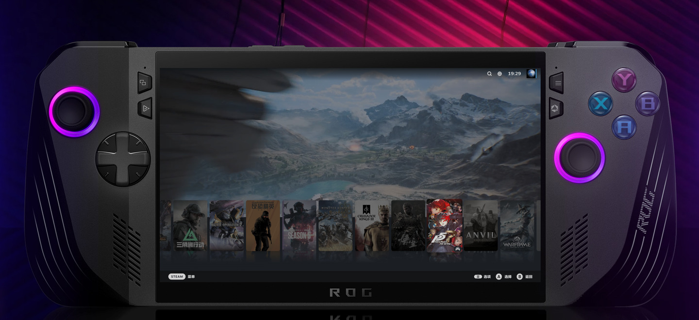

# YeManCC · Windows Handheld Console

[简体中文](README.md) | **English**

## Bring SteamOS-style convenience to Windows.

**Make Steam the home of your handheld.**

YeManCC (YMCC) is an open-source console for Windows PC handhelds. Built around Steam Big Picture, it brings together controller navigation, touchscreen touchpads, performance and cooling controls, dynamic visuals, and game tools. Paired with YeMan System, it keeps choosing a game, adjusting settings, and returning to play in one flow.

*Handheld concept composed from a device photo and an H5 interface. Availability depends on the downloaded version and supported hardware.*

## What it brings to your handheld

| Capability | What it helps you do |
| --- | --- |
| **Bring your games together** | Add non-Steam games to Steam, use one place to browse and launch them, and organize their artwork. |
| **Stay in handheld controls** | Navigate with a controller, map touchscreen touchpads through Steam, and use gyro controls and custom button actions. |
| **Adjust settings inside Steam** | Use the YMCC Decky sidebar for power, frame limits, fans, and common input settings. |
| **Tune performance for how you play** | Choose automatic or manual control, keep separate AC and battery settings, and save profiles for individual games. |
| **Bring your library to life** | Fetch dynamic wallpapers and personalize Big Picture with home layouts, cover reflections, and visual effects. |
| **See the information your way** | Organize FPS, power, and temperature readings with configurable monitoring layouts, positions, and fields. |
| **Keep game tools within reach** | Access OptiScaler FSR / XeSS integration, Lossless Scaling, game speed controls, and trainer tools. |
| **Manage everyday Windows handheld tasks** | Pause a game before sleep and resume the original process after wake, alongside startup, display, and quick-app controls. |

## Preparing 0.0.36

The next-version draft focuses on **boot modes and complete presets, custom controller actions, Steam appearance and integration, game tools, and update diagnostics**. The overview and bilingual release copy are prepared; the published package will define the final scope.

[Read the English 0.0.36 release draft](docs/release-notes/v0.0.36.en.md) · [中文发布稿](docs/release-notes/v0.0.36.md)

## Download and get started

Download the complete **YeManCC.zip** package from [Releases](https://github.com/DaVeZhouMK/YeManCC/releases). YeMan System and the required components provide the intended environment.

[Installation and build guide](docs/getting-started.en.md) · [Report an issue](https://github.com/DaVeZhouMK/YeManCC/issues)

Hardware controls, game tools, and monitoring outputs depend on the device, game, and supporting software. The radial menu is a test feature. Low background overhead and handheld usability remain development goals; performance and battery life require measurements on the actual setup.

## Open source

YeManCC is licensed under [GPL v3](LICENSE). Feedback, contributions, and customization are welcome. Third-party tools retain their own licenses.
