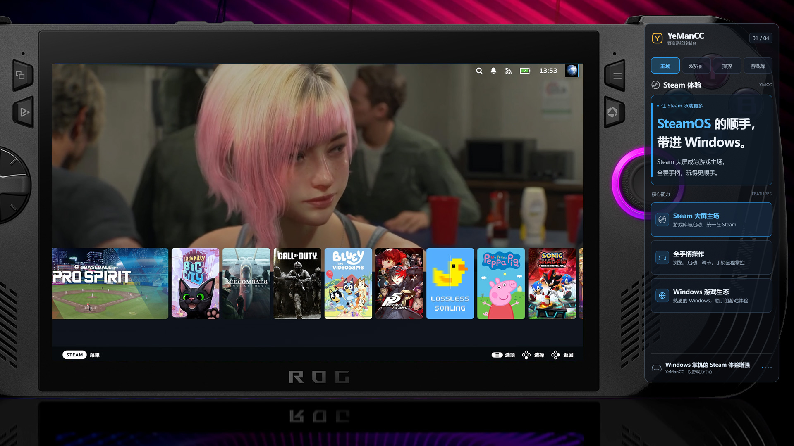
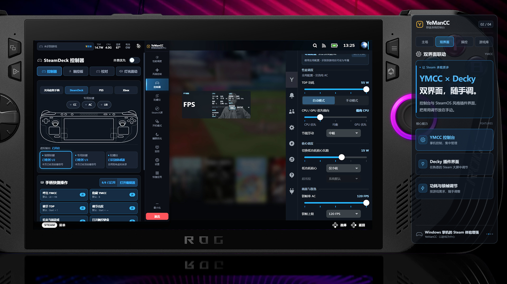
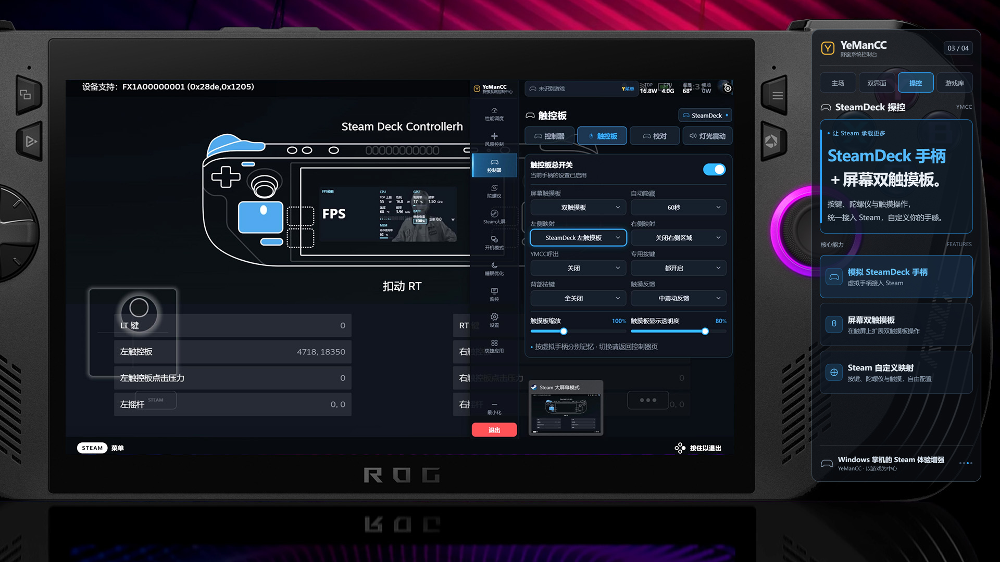
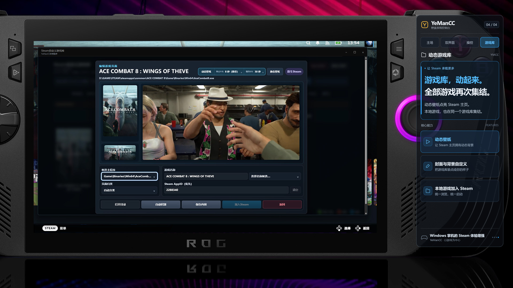

# YeManCC · Windows Handheld Console

[简体中文](README.md) | **English**

## Bring SteamOS-style convenience to Windows.

**Let Steam do more. Keep your handheld focused on play.**

YeManCC (YMCC) is the open-source handheld console for YeMan System. Built around Steam Big Picture on Windows, it brings controller navigation, Steam Deck-style input, performance controls, and a dynamic game library together. Paired with YeMan System, it connects choosing a game, adjusting settings, and returning to play in one handheld experience.

[Download the complete package](https://github.com/DaVeZhouMK/YeManCC/releases) · [Installation and build guide](docs/getting-started.en.md) · [Report an issue](https://github.com/DaVeZhouMK/YeManCC/issues)

## 01 · Make Steam the home of your handheld

Enjoy SteamOS-style convenience while keeping the Windows game ecosystem. **Steam Big Picture provides the game hub; YMCC brings the handheld controls.** Browse your library, launch games, and adjust common settings with a controller, keeping your attention on the game.

## 02 · YMCC × Decky: two interfaces, easy adjustments

**A full console and an in-Steam sidebar give you two ways to manage the same handheld.** The YMCC console brings performance, cooling, and input controls together. Its SteamOS-style Decky plugin interface puts power, frame limits, fan controls, and common input settings inside Steam Big Picture. Choose the interface that fits how you play and adjust it with your controller.

## 03 · Steam Deck controller + touchscreen touchpads

**Add dual touchpad controls on the screen, even without physical touchpads.** YMCC provides a virtual Steam Deck controller and connects buttons, gyro input, and touchscreen touchpads to Steam Input. Configure the touch areas and mappings for your habits. Let Steam handle the input, with customization in the player's hands.

## 04 · Bring your library to life and your games together

**Animated wallpapers bring your Steam home to life, while local games join the same library.** Fetch dynamic wallpapers, organize covers and backgrounds, and add non-Steam games to Steam for unified browsing and launching. Make Steam both your game hub and your handheld's personal home screen.

## Built around Steam, with more within reach

| Capability | What it helps you do |
| --- | --- |
| **Performance and cooling** | Choose automatic or manual control, keep separate AC and battery settings, save profiles per game, and manage fans on supported devices. |
| **Custom game monitoring** | Combine FPS, power, and temperature readings with configurable styles, positions, and fields. |
| **Game tools** | Access OptiScaler FSR / XeSS integration, Lossless Scaling, game speed controls, and trainer tools. |
| **Windows sleep and resume** | Improve continuity with a workflow built around pausing before sleep and resuming the original game after wake. |
| **Handheld shortcuts** | Manage boot modes, displays, dedicated buttons, and quick apps with fewer trips to desktop settings. |

Images combine handheld and software interface assets to illustrate features. Availability depends on the version, device, game, and required components. Performance and battery life require measurements on the actual setup.

## Download and get started

Get the complete **YeManCC.zip** package from [Releases](https://github.com/DaVeZhouMK/YeManCC/releases), where you can also find version updates and change notes. YeMan System and the required components provide the intended environment.

[English installation guide](docs/getting-started.en.md) · [中文安装说明](docs/getting-started.zh-CN.md) · [Report an issue](https://github.com/DaVeZhouMK/YeManCC/issues)

## Open source

YeManCC is licensed under [GPL v3](LICENSE). Feedback, contributions, and customization are welcome. Third-party tools retain their own licenses.
