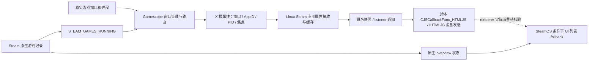

# Gamescope、Steam 与 YMCC 的真实联系层

核验：2026-10-15。对应研究目录 `G:\YeManCC-Work\Docs\Research\Sleep\SteamNonSteamRecovery-20261011\WEB-GAMESCOPE-DEEP-LIFECYCLE-20261014`。本文从已有 R40 运行期关联层继续比较实际发送、接收、状态所有权和恢复；不是新运行时开关，也不是原游戏恢复已成功的声明。

## 已证实的核心差异

Gamescope 直接管理自己的显示会话、Xwayland/Wayland 窗口和输入路由，并向 Linux Steam 回报真实窗口、AppID/PID 和焦点。Steam 同时向 Gamescope 发布已运行游戏计数。两个方向由不同代码拥有，不能合并成“Gamescope 给 Steam Running 续租”。

Windows Steam 也有原生焦点通知：已有游戏记录和焦点缓存生成 callback，SteamUI 接收后生成前端快照。YMCC R40 在外部联合观察同一原游戏、Steam 和 UI，目前没有取得 Steam 支持的原游戏登记恢复入口。要继续做中间层，应补齐真实生命周期信号的发送、接收和确认契约，而非持续重写 AppID、Running 或 UI 列表。

| 维度 | Gamescope / Linux Steam 的已证实路径 | Windows Steam / 当前 YMCC | 结论边界 |
| --- | --- | --- | --- |
| 窗口、渲染和路由 | Gamescope 管自己的 Xwayland/Wayland 对象，先完成真实路由再发布状态 | Windows 窗口由 OS/游戏拥有；YMCC 读取原实例和窗口 | YMCC 持句柄不能成为现有游戏的 compositor 或父进程 |
| 焦点、可聚焦窗口 | 根属性传真实窗口/AppID/PID，Linux Steam 订阅属性事件并读入缓存 | Windows native 已有 GameID/PID 快照和 UI callback；YMCC 只读核验 | 接收焦点不等于重新登记原游戏 |
| 游戏运行计数 | Linux Steam 写 `STEAM_GAMES_RUNNING`，Gamescope 读取 | Steam backend / tracker / overview 与 UI 列表分别观察 | 计数没有 PID/birth/账号租约，不能反向冻结 |
| 大屏运行列表 | 两份已核验完整 UI 包有 `IS_STEAMOS` 窗口 fallback | 普通 Windows 不满足该平台条件；R30 只在 native 真正 Running/Launching 时重算列表 | SteamOS 列表保留不证明 native 状态、输入或 Continue 按钮健康；Linux 桌面也不能一概套用 SteamOS 条件 |
| 会话恢复 | session-active 触发 DRM 连接器/CRTC/模式/显示资源重建 | R40 保留同一原实例的联合观察，睡眠动作由已有独立 owner 管理 | 显示重建不是 Steam 原实例 Running ACK |
| 进程监督 | watchdog/reaper 监督调用者交给它的命令；keep-alive 保持 compositor，respawn 创建新实例 | YMCC 不能靠重启满足“同一原游戏”目标 | reaper PID 不必是真游戏 PID，两个 reaper 的角色也不同 |
| 生命周期确认 | 窗口/surface/进程各有创建、销毁和事件对象 | R40 固定句柄/PID/birth/path/session/完整 GameID/Steam账号，共享候选一致和分歧分别记录 | 当前实现是联系与证据层，尚无 native 重挂权限 |

## 数据方向与不能跨越的状态边界



专用属性接收、缓存、具名快照构造、实际listener实现、JS登记绑定和native消息发送已核验；renderer实际执行、原实例恢复确认仍有缺口。图中的通知出口不代表UI实际收到或游戏已恢复，也不代表普通焦点callback承接了这份数据。普通 focus callback 在 Gamescope 模式下主动返回，不能与专用接收端按名称相似拼接。

`gamescope-xwayland` 的 buffer override 管渲染映射；输入仍走 Xwayland 映射。调试命令 ACK、统计事件、属性读取、焦点快照和 UI `update_complete` 均不是原游戏 Running 重挂 ACK。

## 源码中的会话恢复具体做什么

固定 Valve commit：`2b5cf191d1047d6895516a834de8a72ac1c342f3`，本轮 GitHub API 核验时为 head；提交时间 `2026-10-14T02:37:15Z`。后续升级必须重新核验，不能把这个 commit 永远当最新版。

`handle_session_active → DirtyState → drm_poll_state → refresh_state → setup_best_connector` 是显示恢复链。active=true 请求强制重新选择/设置显示资源，并更新现有 Xwayland 的 output 信息。此路径不负责重启原游戏，也未见注册原 Steam 游戏记录的契约。

session.active 同时可表示 VT 所有权，不含 Windows S3 枚举、游戏 PID/birth 或 Steam Running 确认。`PollState=true` 只说明处理过待刷新状态，调用处没有汇总所有底层返回；应另看 DRM 提交结果，不能连显示已成功都仅凭它认定。

监督链也不能替代关系层：`SpawnProcessInWatchdog` 返回的是 gamescopereaper 包装进程 PID；是否启动 Steam 由命令尾部决定，`--steam` 自身不替你启动 Steam。`gamescopereaper` 与读取 `SteamLaunch AppId=...` 的 Steam `reaper` 是不同角色。cgroup/祖先查询读取标签，并不创建游戏租约。

源码引用：

- [真实 focus 发布和 Running 属性处理](https://github.com/ValveSoftware/gamescope/blob/2b5cf191d1047d6895516a834de8a72ac1c342f3/src/steamcompmgr.cpp)；精确行与哈希见研究 `gamescope-direction-excerpts.json` 和 R40 `gamescope-source-evidence.json`。
- [DRM 资源恢复](https://github.com/ValveSoftware/gamescope/blob/2b5cf191d1047d6895516a834de8a72ac1c342f3/src/Backends/DRMBackend.cpp)；逐条件链与行号见 `agent-process-lifecycle.md` 第8节。
- [Process/watchdog 与 AppID 标签读取](https://github.com/ValveSoftware/gamescope/blob/2b5cf191d1047d6895516a834de8a72ac1c342f3/src/Utils/Process.cpp)、[reaper 的退出和 respawn](https://github.com/ValveSoftware/gamescope/blob/2b5cf191d1047d6895516a834de8a72ac1c342f3/src/Apps/gamescopereaper.cpp)。

## 已追到的 Steam 接收端与 Windows 刷新端

以下是固定包的静态地址，不能跨版本直接调用。没有加载、执行或向 Steam 注入任何分析模块。

### Linux 专用接收

官方 Ubuntu12 manifest 快照为 `1791918634`；研究对象是 ELF32 `ubuntu12_32/steamui.so`，不是 Proton 游戏模块。

- `0xf0f950` 登记 focusable/focused 等 Gamescope 根属性；`0xf0fd19` 用 `PropertyChangeMask=0x400000` 订阅变化。
- `0xf0f1c0` / `0xf0bb60` 实际使用 `XGetWindowProperty` 读取数组/标量；`0xf12840` 处理 `PropertyNotify=28` 并更新属性缓存。
- `0xf108a0` 读取该缓存，已定位多个实际消费者；其中 `0x1afd500` 明确检查 `Plat_IsGamescope` 再走专用分支。
- 补齐专用消费者 `0x183a290 → 0xf108a0 → 窗口元组转换 → 0x1a139c0 → 0x1a13860 → 0x2541d40`：构造具名 `focusedApp / rgFocusable` 快照，在 `0x2541eac` 以listener vtable `+0x14` 实际间接调用；调用后不检查通知返回。2026-10-15已补齐具体listener及JS登记到native消息出口，详见后文；renderer消费与恢复ACK仍未证明。证据见 `agent-linux-focus-bridge.md`、`linux-focus-bridge-validation.json`。
- `0xf0cab0` 是反方向的 Running 计数写端：非零 `XChangeProperty`，零 `XDeleteProperty`。源计数的全部上游所有权尚未追完，不能赋予它原游戏租约语义。
- 普通 `0x1a19270` 在 `Plat_IsGamescope` 为真时直接退出。这条常规 callback 不能强接到专用属性事件路径。

Gamescope窗口元组里的DWORD AppID不是Windows完整GameID或OS birth凭证；YMCC仍须使用自己的完整tracker与原实例联合校验，不能拿窗口元组替换。

取证限制：54段 HTTP206 的范围/长度、ZIP中央与本地成员名/尺寸、解压 CRC32 均核验；完整76MB包未下载，manifest 的整包 SHA256 **未核验**。成员本地 SHA256 为 `57fe9388aa45cd3f65cb26de8e2274698ffa4e284f0021c7e8a6e028da1995ca`。出处和限制见 `linux-module-receipt.json`；PIC/FDE与静态指令检查见 `linux-native-static-validation.json`。

### Windows 已有的常规焦点路径

历史 Windows native `1788652215`：

```text
已有游戏记录数组 + engine 当前 focus缓存
  → steamclient64.dll 0x9881d0 → callback 0xfdeac
  → SteamUI.dll 0x640110 → 0x63e7a0
  → focusedApp/rgFocusable JSON → UI store
```

producer 读取既有记录数组；当前 focused GameID 不在该数组时也能追加为 focusable。因此不能用焦点列表成员证明 native Running 记录存在。SteamUI 常规转换同样检查 `Plat_IsGamescope`，Gamescope 为真时不走这条路径；Windows转换将 windowid 置零，字段名不等于真实 HWND 挂接。

本轮进一步找到两个 producer 直接触发点：

1. 焦点缓存 setter `0x989420`：通过 engine 子对象 `+0xc40` 写有效偏移 `+0x1989` GameID 与 `+0x1994` PID，随后触发 `0xfde8f` 和快照 `0xfdeac`。setter 位于该子对象 vtable `+0x180`（slot48）。进一步通过RTTI非虚基类PMD及实际IPC分发，已确认这是 `IClientUtils::SetFocusedWindow`；实际Windows发起者已定位为SteamUI的 `CVGUIApplicationSteamUI::RunFrame`（后文），读取真实前台窗口及所属PID。
2. 带 Game process added/updated 诊断的处理路径 `0x9d96a0`，在 `0x9da019` 触发同一快照。具体完整函数名未取得，不凭字符串给它命名为已证实“重新挂接”。

setter 的同 GameID 去重可以被传入 flag 绕过；flag 的完整语义尚未证明。不能据它直接归因睡醒不刷新或提出强制重放。新证据见 `windows-focus-trigger-static.json`、`windows-focus-setter-static.json` 和19条独立字节/地址核验 `windows-focus-trigger-validation.json`；此前28条 Windows接收指令复核见 `windows-agent-byte-review.json`。

新增IPC闭环：客户端proxy `0x863470` 序列化焦点GameID/两个布尔字段/PID/两个16位字段；服务端 `0x826920` 中标识为 `IClientUtils::SetFocusedWindow` 的 `0x828a91` 分支读取字段，通过 `0x828c31` 的slot48和 `0x828c68` 的虚调用进入已知缓存setter。反射方法名、匹配的RTTI基类偏移、vtable和17条关键指令独立核验在 `windows-focus-ipc-validation.json`。这些字段没有OS创建时间/原账号租约；两个布尔字段的完整语义未全部证明；实际客户端调用方已定位，PID变化会设置绕过去重的参数（后文）。它是内部焦点协议，不是已经证明的公开原实例恢复API，不能向它发送伪造窗口状态。

### SteamOS 的 UI 差异不等于所有 Linux 差异

完整官方 stable `1788652215` 与 publicbeta `1791856936` 的 library.js 已核验：ScopeRunningApps 的窗口 fallback 谓词返回 `IS_STEAMOS`，属于 UI 列表派生；未改 native local display_status。

较新 `1791918634` 的 sp.js 使用同一导入谓词，但对应完整 library.js 未取得，不能声称较新版本已独立核验相同定义。Windows历史native与Linux本轮ELF也不是同版本、同架构受控实验，不能把二进制差别直接当本次故障因果。

## YMCC 应继续补什么

R40 已经提供可持续读取的原实例联系：[STEAM-RUNNING-LINK.md](STEAM-RUNNING-LINK.md)。它把 YMCC单PID、原OS句柄/birth/path/session、完整tracker/primary、原Steam实例与账号、真实UI联合到一起，保留未知与来源分歧。它没有原生续租或重挂能力；本轮也没有更改该运行时代码。

后续分三段推进，每一段都需要独立证据：

1. **真实信号来源：** 追 Windows 已定位 `IClientUtils::SetFocusedWindow` proxy 的实际OS/UI调用者、缓存去重/刷新条件，以及游戏记录新增/更新与退出在睡眠后的实际触发。窗口与 GameID/PID 信号必须对应同一原实例，不随焦点换游戏。
2. **接收与权限契约：** 找到 Steam 对原记录真正登记/确认的受支持入口或已核验平台行为。只有焦点listener通知、前端列表或 `update_complete` 不够；未知接口保持研究态。
3. **现场因果对照：** 使用同机同版本正版与非Steam的用户授权20秒观察；核对同一PID/birth的OS、tracker、native overview、UI以及时间校正。原关联连通后再分别验收输入和睡眠。

如有明确、可复现的 YMCC 生产缺陷再改源码、补必要回归与隔离编译。现有研究没有证明一个可安全新增的 Windows原实例重挂操作，不调用内部地址、伪造平台标志、冻结AppID/Running、覆盖listener、安装设备或重启游戏。没有证据证明 Gamescope 是唯一自愈方法，也未证明它本身保证任何非Steam原实例的真实输入或 Continue 恢复。


## 发送者与实际listener补齐（2026-10-15）

Windows历史1788652215模块中，真实发送者是 `CVGUIApplicationSteamUI::RunFrame`，读取 `GetForegroundWindow`、窗口所属PID，再通过已核验 `IClientUtils` typed getter调用slot48的 `SetFocusedWindow`。调用现场比较新旧PID，PID变化时显式设置绕过去重的参数；不能从setter只比较GameID就推断“PID改变不更新”。GameID选择helper调用的是 `GetGameOverlayUIInstanceFocusGameID`，不是相邻的 `GetFocusedGameWindow`。后续经client proxy、server、原生缓存producer与SteamUI生成快照。29项关键指令/import/data-flow复验通过，地址仅属固定历史包，不可跨版本调用。

Linux1791918634 ELF32模块中，`System.UI.RegisterForFocusChangeEvents` 的真实handler `0x1a12f80` 登记到 Gamescope消费者同一 `CSteamUISharedJSController+0xbc` 列表。通知listener为 `CJSCallbackFunc_HTMLJS`，实际slot+0x14进入 `0x253fba0`，向保存的IHTMLJS实例slot+0x4传快照/callback。`CHTMLWindow` 对应实现 `0x167aea0` 构造 `CMsgJSExecuteCallback` 并发送0x21消息。窗口失效由有效性gate/后续分发清理。出口不检查消费者返回值，因此这条链闭合的是native通知发送，不是游戏Running ACK或输入消费。固定ELF成员hash及绑定复验通过；完整ZIP publisher SHA仍未核验，运行时transport/renderer实例、显式JS单项退订入口未静态证明。

本机2026-10-15已按原Steam PID/birth/root、helper parent/session、127.0.0.1:8080原listener owner和原账号89250578验证一个20004ms的临时订阅。收到真实桌面配置AppID413080/PID20436/windowid0快照，账号前后相同且自己的订阅成功退订。当时没有2077/ACE8进程；桌面快照不能充当原游戏证据。本机账号源为 `settingsStore.m_CMInterface.steamid.GetAccountID()`，没有使用不存在的 `SteamClient.User.GetAccountID()`。

R41接收这一真实native反馈并与固定原AppID/PID及独立UI状态对照，详见 `STEAM-RUNNING-LINK.md`。仍缺的是：在同原游戏持续运行/失联/唤醒时，native窗口集合、Overlay GameID选择、原生运行状态与实际输入/Continue的同时间证据，以及受支持的同原PID运行关联恢复契约。不能用伪Steam正版、平台flag、冻结Running或重复focus发送填补这些缺口。

静态证据：研究 `WEB-STEAM-FOCUS-ENDPOINTS-20261014/windows-native-focus-chain-validation.json`、`linux-listener-REPORT.md`、`linux-listener-validation.json`；本机证据 `live-native-focus-receipt.json`。历史目录名20261014不代表本轮日期。


用户随后启动非Steam2077，R41生产JS在原Steam传输上完成20秒/4次只读采集。OS原游戏PID45256/birth134364700566595639与原Steam身份持续一致；native focusable均包含真实游戏AppID4131894616/PID45256，UI完整GameID17746352246272032768、local Running4和列表成员同时一致，前后tracker/console的原启动记录匹配且采集尾部未见目标移除。当前焦点另指桌面配置；这说明焦点与运行关联可以分别变化，不能以焦点桌面反推游戏失联。本机Controller列表为空，未测睡眠/手柄/Continue，未观测权威YMCC单PID准入；生产JS接收实测不等于R41 native已部署。记录在 `ROUND41-NATIVE-FOCUS-FEEDBACK/live-2077-analysis.json`。


## Overlay焦点记录写端与通知（2026-10-15后续）

已明确定位同一typed IClientUtils的 `SetOverlayWindowFocusForPipe`：反射client/server与slot52绑定实现0x989db0。它写入getter读取的同一树（owner+0x118/backing+0x148）：整数键+0x10、两个布尔+0x14/+0x15、packed GameID+0x16。第一标志变化沿0x984110发送 `OverlayGameWindowFocusChange_t`（ID0xf90c9，长度实参1），不是同原PID/birth/Running重挂确认。37关键指令和3vtable项独立复验通过。

因此“锁定焦点信号”不能直接等同保持游戏运行关系；需核验真实Overlay pipe生命周期、树清理和通知consumer，不能替他人的pipe写入布尔或调用历史地址。fallback对象身份、第二布尔/时间路径语义、完整Running移除链仍未知。证据见研究 `WEB-STEAM-FOCUS-ENDPOINTS-20261014/windows-overlay-focus-owner-REPORT.md` / `windows-overlay-focus-owner-validation.json`。此后续只新增静态证据和文档，R41代码/既有隔离构建未变，不需要再次编译。


## Overlay 通知 consumer 与 Linux 运行计数边界（2026-10-15）

Windows通知ID0xf90c9的两个实际consumer已核验：CSteamOverlayActivateWatcher把同一dirty byte置位，RunFrame检查并清除，作用是安排焦点复查；CSteamUISharedJSController调用真实typed IClientUtils::GetFocusedGameWindow，再把AppID/PID发给JS listener。第二回调嵌入controller+0x38，其listener是callback-this+0xb8，在该对象组合内为controller+0xf0。不能把其中一个相对偏移当成另一对象的字段。37条指令、3leaf和2RTTI/vtable复验通过。

Valve JS的OnOverlayGameWindowFocusChanged存储AppID/PID，并供Overlay窗口fallback消费。这说明通知有具体焦点消费者；具名JS登记到native列表的静态绑定现已通过完整API名称xref、typed member-handler和原owner传递补齐（40条关键指令）：handler0x63f640登记同owner+0xf0，且立即回传owner缓存GameID/PID。首份callback因而不是native状态刷新确认；这一链仍没有Running reattach确认或真实输入回执。不能从它推导锁定AppID/PID可以保留Running。详见研究WEB-STEAM-FOCUS-ENDPOINTS-20261014/windows-overlay-focus-consumers-REPORT.md。

Linux的STEAM_GAMES_RUNNING写端仅闭合了入口DWORD到X11根属性：非零写一项CARDINAL32，零删除。它由Steam模块写出；实际调用者和计数producer所有权仍未定位，不能当作Gamescope向Steam确认游戏运行的接口。57指令、56 CFG栈状态、5符号绑定和12语义项复验见linux-running-owner-REPORT.md；整ZIP来源哈希与跨版本对照限制保留。


## Linux具名Overlay登记与本机S3反例（2026-10-15）

Linux1791918634的RegisterForOverlayGameWindowFocusChanged登记路径也已按实际完整名xref、typed member-handler/原owner、RTTI和参数核验：handler0x1a13330→owner+0xa0列表，并立即用缓存GameID+0xf0/PID+0xf8回传AppID/PID。Windows历史1788652215为handler0x63f640→owner+0xf0列表，缓存+0x168/+0x170。两平台首份callback都不构成新鲜Running状态或恢复确认。

Linux实际Overlay通知consumer尚有getter slot+0xd8的具体来源待核验，不能仅按slot与Windows+0x1b0同为54就拼接口；callback登记路径无显式Running刷新，不等于所有下游无副作用。949次指令、9PIC、45数据字/重定位和23绑定检查通过，见linux-overlay-focus-registration-REPORT.md。整LinuxZIP publisher SHA及跨版本因果限制保留。

Windows native PID变化分支另已绑定Steam Service的IClientProcessMonitorMap旧PID注销/新PID登记；这是客户端进程监测协议，不是已证实的游戏Running删除/恢复或ACK。实际service实现来源仍在定向核查，不调用该内部接口。

本机真实S3后，在原2077/Steam身份匹配的一次延后读中，native focusable仍含原tuple而overview11/list为空。这个反例把目标进一步收窄到真实运行状态生命周期，不能靠保住窗口/focus元组或伪装SteamOS/正版状态解决。原20秒Steam观察采集失败，具体时刻/producer未知，实际输入/Continue未测。证据及采集修复在ROUND42-S3-CAPTURE-READINESS；没有native runtime变更或部署。


## 2026-10-15：同版本进程存活差异与服务端边界

已使用官方完整包的 publisher SHA256 固定 Windows／Linux **1791918634**，定向对照 `ThreadIsProcessIdActive`。Linux 对 `kill(pid,0)` 的非 ESRCH 错误及后续 `waitid` 的 ECHILD 路径保留 active；Windows 在 `OpenProcess(SYNCHRONIZE)` 失败或零等待结果非 WAIT_TIMEOUT 时返回 inactive。这是实际叶函数分支差异，不能自动证明现场权限失败，更不允许将 Linux 的宽容返回复制成 YMCC 原实例准入或恢复权限。

Linux真实游戏记录遍历同样有双PID检查、条件移除和 `OnAppRunningEvent(false)`：旧flags0x2004→新flags4，事件0x1360f6/16bytes。因此Linux的正常体验不能单凭Gamescope焦点信号解释。原记录PID、实际查询结果、具体状态producer仍需分别闭合；只读PID/窗口反馈不会锁住Running。

此前Linux `steamui.so` 全包来源缺口已补齐：完整76109237bytes包SHA256 e2186c3a1d76fca05d71a0e2119fd8adad0c4ac46dd6fb4c8cd6e232153db5cf 与缓存官方manifest一致，原range提取与整包成员逐字相同。新 `steamclient.so` / `libtier0_s.so` 也由该包提取。旧报告中的未核验限制保留为历史；此次补强不保证任何现场已载镜像身份。

Windows1788652215的Service端也已取得并按构造/vtable/RTTI绑定 RegisterProcess/UnregisterProcess。Register会自行采集创建时间；协议固定response1并不取决于OS查询/登记结果，不能当Running恢复ACK。详见研究 `WEB-STEAM-FOCUS-ENDPOINTS-20261014/windows-process-monitor-service-archive-REPORT.md`。退出事件已追到typed provider缓冲读取；其实际reader与Running仍未绑定，见同目录windows-process-monitor-lifecycle-REPORT.md。

来源、完整指令和独立29项/1669指令校验见研究 `WEB-LINUX-PROCESS-LIFETIME-20261015/REPORT.md` 与 `validation-same-version.json`。这些是静态证据核验，不是游戏输入/Continue或实机睡眠验收。本次没有runtime修改或native重编/部署，marker仍 `steam-wake-round41-native-focus-feedback`；R42采集修复和原身份/账号/开关/58.5s/60s边界不变。

## 2026-10-15 两平台Overlay getter与Running记录的实际成员关系

Linux的具体IClientUtils GetFocusedGameWindow已闭合到CSteamEngine+d28/getter1990590；PID lookup使用CUser+1d04/+1d10、stride1190，与具名IClientUser GetRunningGameID的同对象成员一致，45项/1408指令复验通过。Windows历史1788652215也核验了自己的具名getter、RTTI和实际字段别名：CUser原对象+2538/+2548、stride330，67项/1607指令通过。Windows和Linux这两份getter历史版本不同，不作为同版OS差异结论；同版活性查询对照另见前节。

两端都可以从已存Overlay focus记录转向原生游戏记录取PID，这证明一个具体的消费联系，没有证明持续续租、Running写入、缓存新鲜度或重新挂接。普通focusable通知和Overlay通知是不同通道，不能把R41的普通首份窗口快照当作本轮getter的fresh结果。Gamescope持续管理窗口的模式仍可借鉴；是否、何时更新真实游戏记录仍要以producer契约为准，不能用“锁定信号”或显示伪装填空。

原Steam实例只读模块检查被VM_READ权限error5阻止，而有限查询身份成功；尚无现场已载模块hash。该证据既不能推断Steam token，也不能推定原S3是活性查询权限失败。只做磁盘反汇编，未attach、提权或执行Valve模块。研究记录 `WEB-NATIVE-RUNNING-READ-20261015`；runtime仍R41，无新游戏/Steam动作、睡眠、输入设备动作或验收。

Windows的User.ResumeSuspendedGames也已具体核验到typed native job和PID消费：它是内部suspend标记筛选的用户级现有记录集合，不携带原PID/birth；空集合/取消也可发布state1/result1，不能看见回执便类比Gamescope持续对象关系已经恢复。197项/3535指令独立PASS，详见 `WEB-USER-RESUME-CONTRACT-20261015/REPORT.md`。这一接口不是两平台完整同版本行为对照；Linux对应resume producer/consumer尚未在本项核验。


## 2026-10-15 原记录存活、Overlay 对象与 Linux Resume 的新增边界

固定历史 Windows1791918634 中，CUser RunFrame 的实际 liveness 失败分支已绑定原记录移除；primary PID 与受条件限制的辅助 PID、Overlay 命名对象兜底必须分别核验。相同官方包的 x64 GameOverlayRenderer 已闭合从 `SteamGameId` 完整值创建 `SteamOverlayRunning_<fullGameID>-IPCWrapper`、持有对象到清理 CloseHandle；1788652215 对应链也已核验。client 检查区分对象已存在与新创建，未检查事件 signaled 状态。外部持句柄会改变这种生命周期判定，不能据此锁住真实 Running 或输入；YMCC 没有新增此操作。

同版本1791918634 Linux frame 另有主 PID 失败后读取保存的另一 PID 并保留记录的分支；具体字段写端未跨平台配对，不能认定是实机 S3 根因。来源、112项/8291指令验证及限制见研究 `WEB-WINDOWS-RECORD-LIFECYCLE-20261015/REPORT.md`、`validation-final.json`。原 Steam 与2077的只读token证据均为高完整性；诊断器自己的VM_READ拒绝不等同Steam无法访问游戏。

Linux具名 Prepare/Resume已另闭合77项/4505指令：恢复内部标记集合和保存PID，monitor缺席时同包tier0可直接请求SIGSTOP/SIGCONT；逐PID结果在本层未消费。它不提供任意存活游戏重新挂接或输入ACK。该Resume对照Windows178，不能与上面的179同版frame比较混淆。详见研究 `WEB-LINUX-RESUME-CONTRACT-20261015/REPORT.md`。本轮无runtime、恢复权限或部署变化，marker仍R41，实际输入与Continue仍待证明。


## 2026-10-15 保存 PID 写端、容器根与 Overlay DLL 清理

固定Windows1788652215与1791918634的实际写端已核验：新记录将传入PID写入两个字段，之后一个字段可独立更新；迁移命中时分别改成剩余tracked list首项。因此Steam保存的“最初”字段也不是不可变OS原实例，不能替代YMCC的PID/birth/path/session与精确tracker联合权限。AdvertiseGame对应typed槽更新的PID参数为0，Overlay PIDstream辅助字段也不更新主PID；都没有已证原实例重挂契约。Windows101项/4568指令，证据 `WEB-WINDOWS-RECORD-PID-WRITERS-20261015/REPORT.md`、`validation-final.json`。

同版Linux179的对应初始化/更新/迁移已独立核验，另有沿/proc status PPid链寻找名为pv-adverb祖先候选、用作container root PID的路径。该名称/数值候选不是出生身份或实际容器归属确认，不能通过命名helper仿造。Linux62项/3158指令，见研究 `WEB-LINUX-RECORD-PID-WRITERS-20261015`。真实进程监督/容器与Gamescope焦点反馈是需分别核验的层，尚未证明哪项导致本机睡眠差异。

两份renderer的对象关闭已从PE DLL入口绑定reason=0、user32和对象指针gate；正常attach和thread reason2/3不走该显式关闭，attach失败包装层也可能以0回调。清理前wait对象是mutex，不能推定worker退出；外部谁触发卸载/进程结束、是否最后handle消失及S3因果未知。212项/4108选定指令，见研究 `WEB-OVERLAY-OBJECT-CLEANUP-20261015`。

官方Steam Input gamepad-emulation说明区分Windows Overlay API挂接与macOS/Linux驱动路径；这仅是输入架构背景，不证明Running重挂或Gamescope唯一自愈。升级时同时重核真实进程登记、模块生命周期、Running消费和实际输入回执；不采用presence/对象持有/焦点元组代替。原实例联合权限、单开关、Off与58.5/60秒边界未变，本轮runtime仍R41，无部署。


## 2026-10-15 Overlay 自卸载候选的已界定检查

固定1788652215/1791918634 renderer各12处literal direct-IAT FreeLibrary已归属到选定完整函数，涉及NVIDIA库、系统库缓存、CLR临时句柄及延迟加载处理。生命周期原HINSTANCE保存到R15的620条指令作用域内，已证consumer仅DisableThreadLibraryCalls/GetModuleFileNameW，未连到自身卸载；不是全模块/动态调用负面证明。独立109项/3624指令PASS，证据 `WEB-OVERLAY-SELF-UNLOAD-20261015/REPORT.md`、`validation.json`。外部卸载/进程退出actor、现场事件最后handle与S3因果仍未知，不能据此新增模块pin或事件持有。运行时仍R41，无新的Running/Input/Continue验收。


## 2026-10-15 进程注册来源与 Gamescope 输入的分层

同固定1791918634下，Windows已核SetAppIDForCurrentPipe具名proxy/选定dispatcher case/typed slot到具体方法：PID取自current-pipe查询返回对象+20，engine+d8是查找key；payload只有AppId4字节和flag1字节，未提供显式原PID/birth。另一条实际注册来源使用Toolhelp系统PID与远程参数/环境文本筛选，文本匹配不构成OS身份或外部权限。276项/2473选定指令，见 `WEB-WINDOWS-REGISTRATION-SOURCES-20261015`。

Linux对应具名链从current-pipe返回对象+14取PID，engine+9c另作上下文；已核Gamescope输入来自SteamUI X11属性事件与窗口缓存。这只证明所示直接来源分离，没有证明全程序无桥接或稳定supervisor外部契约。38项/521指令，见 `WEB-LINUX-REGISTRATION-SOURCE-20261015`。主代理重跑两份独立validator并匹配26项交付hash；连接PID writer、context设置者、认证sender和Windows扫描器上层触发仍未知，未调用私有入口/编造报文。实际注册结果ACK及同原游戏输入/Continue仍未闭合，runtime仍R41。

## 2026-10-15 Windows pipe PID 來源：已閉合存在性檢查，未取得合法重掛契約

固定 Windows client 1791918634 的静态逆向已把 command 9 的首个 32 位字段追到 peer `+0x20`。Steam 随后通过 `CreateToolhelp32Snapshot`、`Process32First`、`Process32Next` 按 PID 找到 `PROCESSENTRY32` 类记录并复制到 peer `+0x28`。这证明 Steam 有 PID 存在性和基础进程记录检查；选定路径没有证明 PID birth、完整路径授权、token/session、Steam 账号租约、完整 GameID 绑定或注册成功 ACK。

同一 setter 的连接初始化调用在 `0x8a1090` 明确传入 0，因此不能把初始化写入误认为原游戏 PID。pipe/context key、当前 Steam PID、连接处理字段和登记 PID 也已分离记录。`CCrossProcessPipe` 的共享 `+0x0c` 已在 `0x8f4410/0x8f464f` 闭合为连接端当前进程 PID，并与 `+0x08` 对称交叉 `OpenProcess`；这证明 pipe 端点联系，不证明原游戏身份或 sender authentication。 上游 `0x8a05f0` 还要求当前 pipe key、表项和 opcode 9 路由一致；这只是 transport admission，不是原游戏重挂 ACK。

这部分证据只用于维护与升级影响盘点。YMCC 继续使用原游戏单 PID、birth、path、session、精确 tracker、Steam 账号及共享候选联合权限，不通过伪造 PID/AppID/Running、私有 pipe 报文或外部注入来冒充恢复。证据目录：`WEB-WINDOWS-PIPE-PID-SOURCE-20261015/REPORT.md`；独立验证为原 pipe 142 项和 PID contract 29 项 PASS。

