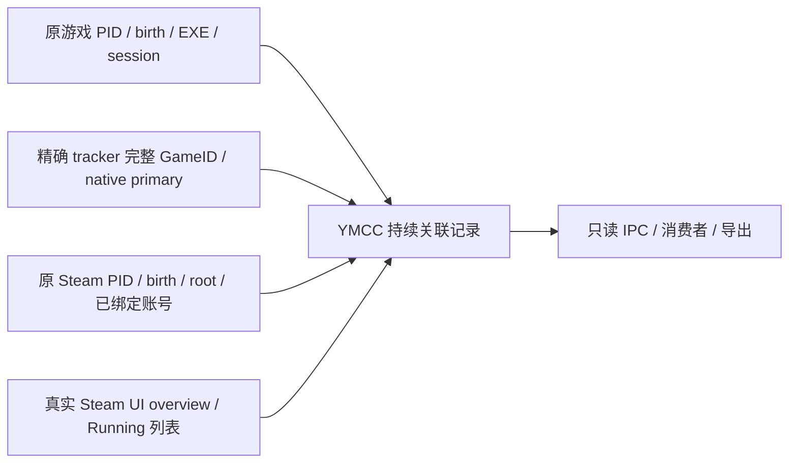

# Steam 运行期关联层

用户在 2026-10-14 调整当前阶段：先持续联系同一原游戏与 Steam，手柄消费和睡眠验收后置。完整最终目标仍保留。初版为 `steam-wake-round40-persistent-game-link`，当前实现为 `steam-wake-round45-identity-contact-layer`；关联层自身标识仍为 `steam-running-link-v1`。

## 已实现的关系

这是一条贯穿原游戏实例生命周期的观察与读取通道，独立于睡眠恢复的操作窗口。保持联系不等于向 Steam 注入续租，不承诺 Steam native 永不丢关联。各来源分别记录；本机 overview 来源仍是 `steam-ui-native-overview-store`。

| 部件 | 修改与消费入口 |
| --- | --- |
| 客户端生命周期 | 原有 `native/steam_session_observer.h`，保留事件驱动进程/账号/root 观察 |
| 持续原游戏状态 | `native/steam_game_link_state.h`：linked、waiting/degraded、closed/revoked/cancelled |
| Win32 / Steam 采样 | `native/steam_game_link_runtime.h`：持原句柄、验证账号、完整 tracker/primary、单 PID、OS 窗口与只读 UI |
| 传输 | `native/steam_live_cdp.h` 与 main.cpp wrapper：仅固定只读操作可用 `runningLinkRead` 的 try_lock/2000ms 独立读取预算；失败保留未知并重试 |
| Native 消费接口 | `steamGameLink.get`，仅取内存快照，不触发新的 Steam 读取/动作 |
| 前端消费接口 | `src/bridge/steamGameLink.ts` / `getSteamGameLink()`；浏览器环境返回 unavailable，不能模拟 connected |
| 导出 | `steam-game-link-current.json`，包括当前快照及最多16条状态变化；原 native 生命周期日志记 `steam-game-link-state` |
| 验证 | `tools/steam_game_link_state_selftest.cpp`、`tools/steam_live_transport_selftest.ps1`、原 wake 接线/导出守卫 |

客户端账号在 Ready 阶段通过已验证的原 Steam PID 的 UI 只读绑定，存于本层私有对象；不写睡眠 owner 的账号缓存/捕获。具体游戏只从精确 tracker/native primary 候选与原有 YMCC 单 PID、OS birth/path/session 的联合验证中绑定。未知候选阻止“严格唯一”判断。原游戏和 Steam 的句柄保持到生命周期结束，活跃记录不会按焦点替换目标。

完整 tracker GameID 保留精确字符串，与32位 AppID、signed alias、OS PID分开；UI GameID必须匹配原记录。native primary的启动器标签不当作实际EXE路径。共享游戏候选只读记录 same-original-instance/different-instance/not-available，不修改共享阀门或用分歧换游戏。

## 活性、失联与边界

正常关联每5秒读一次；证据丢失的观察间隔2秒。读取连接不可用按1/3/8/20/30秒退避，此后维持30秒。该实例持续存活时不因30秒、60秒、分钟或小时健康观察而终结。无活动游戏时由原 Steam 观察通知和日志目录变化唤醒，避免周期性全进程扫描。

`verifiedReadAvailable` 表示本次合格读取可用，`linked` 还要求原身份/账号/精确 tracker/native primary/单 PID/UI关联全部一致。`transportConnected` 在 `state.observe()` 后由运行时原样导出，是独立的两端联系事实：同一已绑定 Steam 进程/账号对 YMCC 返回了未变更的只读请求结果；它不代表 Running 列表、原游戏输入或 Continue。这样可以区分“Steam 通道仍通、原生游戏登记已掉”和“Steam 通道本身不可用”。`fresh` 依据真实采样时刻，不通过读取缓存刷新证据。原进程退出是 closed；独立证明身份或账号变更是 revoked；读不到是 waiting/degraded；原PID仍活但overview11是 native-overview-not-running，不能冒称进程退出。

单个原 `autoWakeRecovery` 开关继续控制此 Steam 观察链；Off/配置代际变化撤销旧记录。新运行实例只在旧记录终结且系统 Ready 时建立独立记录，绝不修改已有睡前恢复目标。后台读不能排队阻塞设置 lane，不能将只读标志借给 setter。读取异常仍保存未知/重试状态。

本层没有 Steam/game/focus/device/sleep 写入，不调用 ScopeRunningApps、RaiseWindowForGame、ResumeSuspendedGames，R40 不创建 listener；R41 只登记并退订本层自己的临时只读回调，不替换 Steam 回调。原唤醒最早58.5秒健康结算及60秒操作权限保持原边界。实际输入与 Continue 验证字段始终false。

## Gamescope 可借鉴与仍缺的部分

可借鉴的是持续维护真实对象、窗口和进程寿命、源状态变化及通讯活性，再向消费者提供一致的关系记录。固定 Gamescope 发送端源码没有提供本任务的 Windows Steam 接收、非 Steam Running续租或同原PID重挂确认契约。本轮官方源码核验见研究目录 `ROUND40-PERSISTENT-STEAM-SESSION/GAMESCOPE-SOURCE-CHECK.md`。

下一步先验证部署后本层在普通启动、持续运行、关闭、窗口重建及读取连接暂断期间的真实记录。当前孤立构建/模拟不算这项验收。只有取得受支持的 Windows反馈/确认接口，才增加真实反馈动作；不能把持续轮询、SDK回调、Backend在线或伪AppID当作已保持游戏关联。手柄消费与真实睡眠仍需各自原实例证据。

已撤销的原实例保留原句柄作为边界，最多16个；只有句柄确认退出才清理。同一仍存活原实例不会因新账号发现或新读取连接而自动重绑，容量不足时保持未知。

## Gamescope 实际接收与生命周期比较（2026-10-14）

完整比较见 [STEAM-GAMESCOPE-COMPARISON.md](STEAM-GAMESCOPE-COMPARISON.md)。本轮补齐Linux Steam对Gamescope根属性的订阅/读取/缓存消费者，Windows已有focus callback及GameID/PID缓存setter，区分SteamOS UI列表fallback、Steam原生运行记录与显示资源恢复。焦点反馈不等于原实例Running续租；已找到Windows更新触发点，但上游OS信号及原实例重挂权限仍未证明。

本轮只新增文档与证据引用；R40运行时代码及既有隔离验证不变，不追加开关、不冻结状态，不把Windows历史native与较新Linux模块当同版本因果对照。研究和下一静态目标见研究目录 `WEB-GAMESCOPE-DEEP-LIFECYCLE-20261014/REPORT.md`、`CONTINUATION.md`。

## R41：接收真实原生窗口反馈（2026-10-15）

`steam-wake-round41-native-focus-feedback` 在原来的运行期只读请求中加入 `nativeFocusFeedbackRead:true`；只有 `sleep.inspect` 且 `runningLinkRead:true` 可使用它。收到 `SteamClient.System.UI.RegisterForFocusChangeEvents` 的首份真实快照后立即退订自己的订阅；没有快照时1000ms后退订。同步回调必须等注册返回handle才清理。注销handle缺失、注销失败或注册抛错会在本JS context隔离后续登记，避免重复泄漏。该读取不查询异步手柄配置，保留原2000ms独立读取预算；普通睡眠/输入检查仍保留原配置检查。

原生反馈独立保存在 `nativeFocusFeedback`。`focusedRelation` / `focusableRelation` 区分同原PID和AppID、同App不同PID、同PID不同App、分离候选、原元组缺席或未知；`originalIdentityBracketMatched` 在异步读取后按原游戏/Steam句柄、账号和配置代际完成核验。所有数据只是诊断，不加入 linked 准入、不授权操作。UI overview在等待回调后重新读取，不能用旧UI值冒充回调后状态。

`windowid=0` 不代表HWND映射；回调没有OS birth、完整GameID和原实例重挂ACK，初次回调还可能是native缓存。`callbackAgeAtReadbackMs` 只表示YMCC收到通知多久，不能代表native窗口状态的真实年龄。完整原身份仍由既有句柄、精确tracker/native primary、YMCC单PID、账号联合校验。接口不可用/结构不符/超时均保持未知，不用 FocusedAppWindowStore 伪造原生回调。

先验证桌面原生callback接收/退订，随后用户启动2077后完成20001ms的4次生产JS只读实测：原PID45256/birth134364700566595639、原Steam/账号/listener固定；native focusable均包含AppID4131894616/PID45256，UI完整GameID17746352246272032768、local4和在运行列表均一致，自己的订阅均退订。焦点仍是桌面配置，不能据此否定游戏关联。该采集没有观测权威YMCC单PID准入或部署后的R41 native生命周期，也没有睡眠/输入/Continue验收。R41主线及隔离构建不代表已部署。证据和回归见研究 `ROUND41-NATIVE-FOCUS-FEEDBACK`。

## 本机原2077 S3反例（2026-10-15）

原PID45256/birth134364700566595639、原Steam/helper/账号保持。睡前overview4/list=true；真实S3后一次延后production JS读取为overview11/list=false，native focusable仍含同原AppID/PID。它证明“原进程+焦点元组”可以与运行关联分离，因此这些反馈不能续租linked状态或授权重挂。首份callback还可能来自缓存，不能替代Running ACK。

OS-channel-stale采集竞态使本轮缺少预定20秒Steam连续观察，底层改变的精确时间/producer仍未知；没有输入/Continue验收。owned两监听已清理，采集工具修复见R42交接；R41 runtime及原联合gate未改、不重编部署。

## 2026-10-15：同版本进程存活差异与服务端边界

已使用官方完整包的 publisher SHA256 固定 Windows／Linux **1791918634**，定向对照 `ThreadIsProcessIdActive`。Linux 对 `kill(pid,0)` 的非 ESRCH 错误及后续 `waitid` 的 ECHILD 路径保留 active；Windows 在 `OpenProcess(SYNCHRONIZE)` 失败或零等待结果非 WAIT_TIMEOUT 时返回 inactive。这是实际叶函数分支差异，不能自动证明现场权限失败，更不允许将 Linux 的宽容返回复制成 YMCC 原实例准入或恢复权限。

Linux真实游戏记录遍历同样有双PID检查、条件移除和 `OnAppRunningEvent(false)`：旧flags0x2004→新flags4，事件0x1360f6/16bytes。因此Linux的正常体验不能单凭Gamescope焦点信号解释。原记录PID、实际查询结果、具体状态producer仍需分别闭合；只读PID/窗口反馈不会锁住Running。

此前Linux `steamui.so` 全包来源缺口已补齐：完整76109237bytes包SHA256 e2186c3a1d76fca05d71a0e2119fd8adad0c4ac46dd6fb4c8cd6e232153db5cf 与缓存官方manifest一致，原range提取与整包成员逐字相同。新 `steamclient.so` / `libtier0_s.so` 也由该包提取。旧报告中的未核验限制保留为历史；此次补强不保证任何现场已载镜像身份。

Windows1788652215的Service端也已取得并按构造/vtable/RTTI绑定 RegisterProcess/UnregisterProcess。Register会自行采集创建时间；协议固定response1并不取决于OS查询/登记结果，不能当Running恢复ACK。详见研究 `WEB-STEAM-FOCUS-ENDPOINTS-20261014/windows-process-monitor-service-archive-REPORT.md`。退出事件已追到typed provider缓冲读取；其实际reader与Running仍未绑定，见同目录windows-process-monitor-lifecycle-REPORT.md。

来源、完整指令和独立29项/1669指令校验见研究 `WEB-LINUX-PROCESS-LIFETIME-20261015/REPORT.md` 与 `validation-same-version.json`。这些是静态证据核验，不是游戏输入/Continue或实机睡眠验收。该静态研究段不包含现场部署；该历史快照的 marker 为 `steam-wake-round43-transport-contact-readout`，R43 修复 transportContact 读取出口不改变原身份/账号/开关/58.5s/60s边界。

## 2026-10-15 具名原生 getter 的数据源已进一步绑定

Windows历史1788652215中，Overlay的具名 `GetFocusedGameWindow` slot54 实现97f330，经registry virtual+0x120取得CUser，再调用PID helper9d61f0。CUser RTTI/构造器明确IClientUser子对象+0x1eb0，具名 `GetRunningGameID` slot132实现539280读取secondary+0x688/+0x698；与PID helper的CUser+0x2538/+0x2548相同，stride0x330。67项/1607指令独立复验通过。关系以相同concrete对象为条件，没有现场同epoch内存读取，没有producer/刷新或恢复契约。

Linux历史1791918634也已闭合具名IClientUtilsMap slot54、CSteamEngine+d28及具体getter1990590，其PID helper和具名Running getter共享CUser array/count。45项/1408指令通过。它是同一平台内的实际成员关系，不能据不同版本两份getter断言OS差异。此前同版OS查询叶函数对照是另一份证据。

**此项研究只绑定Overlay回调使用的getter。** R41实际记录的普通 `RegisterForFocusChangeEvents` focusable元组不能被追溯改标为fresh native Running。首次owner缓存、0值或保存的窗口记录都不能独立验证Steam游戏会话、实际输入或Continue。本轮不改模型字段、运行时、准入或恢复权限。

现场原Steam身份与x64架构已用有限查询句柄核对；加VM_READ的请求error5，未取得loaded-memory身份，且未提权。显式根目录磁盘模块匹配固定样本只是磁盘证明。详见 `WEB-NATIVE-RUNNING-READ-20261015/REPORT.md`；所有Owned采集仍终态，无新采集armed。

User.ResumeSuspendedGames的具体实现已补证（Windows历史1788652215，197项/3535指令PASS）：处理带内部suspend标记的现存记录集合，没有原GameID/PID/birth输入；progress/result不含逐实例身份，空集合亦可发state1/result1。它不提供本关联层所需的原实例重挂确认，范围涉及多PID/云/远端session，故本层保持只读，不加入全局调用。证据 `WEB-USER-RESUME-CONTRACT-20261015/REPORT.md`，升级入口见STEAM-UPGRADE对应节。

## 2026-10-15 原记录存活、Overlay 对象与 Linux Resume 的新增边界

固定历史 Windows1791918634 中，CUser RunFrame 的实际 liveness 失败分支已绑定原记录移除；primary PID 与受条件限制的辅助 PID、Overlay 命名对象兜底必须分别核验。相同官方包的 x64 GameOverlayRenderer 已闭合从 `SteamGameId` 完整值创建 `SteamOverlayRunning_<fullGameID>-IPCWrapper`、持有对象到清理 CloseHandle；1788652215 对应链也已核验。client 检查区分对象已存在与新创建，未检查事件 signaled 状态。外部持句柄会改变这种生命周期判定，不能据此锁住真实 Running 或输入；YMCC 没有新增此操作。

同版本1791918634 Linux frame 另有主 PID 失败后读取保存的另一 PID 并保留记录的分支；具体字段写端未跨平台配对，不能认定是实机 S3 根因。来源、112项/8291指令验证及限制见研究 `WEB-WINDOWS-RECORD-LIFECYCLE-20261015/REPORT.md`、`validation-final.json`。原 Steam 与2077的只读token证据均为高完整性；诊断器自己的VM_READ拒绝不等同Steam无法访问游戏。

Linux具名 Prepare/Resume已另闭合77项/4505指令：恢复内部标记集合和保存PID，monitor缺席时同包tier0可直接请求SIGSTOP/SIGCONT；逐PID结果在本层未消费。它不提供任意存活游戏重新挂接或输入ACK。该Resume对照Windows178，不能与上面的179同版frame比较混淆。详见研究 `WEB-LINUX-RESUME-CONTRACT-20261015/REPORT.md`。本轮无runtime、恢复权限或部署变化，marker仍R41，实际输入与Continue仍待证明。

## 2026-10-15 保存 PID 写端、容器根与 Overlay DLL 清理

固定Windows1788652215与1791918634的实际写端已核验：新记录将传入PID写入两个字段，之后一个字段可独立更新；迁移命中时分别改成剩余tracked list首项。因此Steam保存的“最初”字段也不是不可变OS原实例，不能替代YMCC的PID/birth/path/session与精确tracker联合权限。AdvertiseGame对应typed槽更新的PID参数为0，Overlay PIDstream辅助字段也不更新主PID；都没有已证原实例重挂契约。Windows101项/4568指令，证据 `WEB-WINDOWS-RECORD-PID-WRITERS-20261015/REPORT.md`、`validation-final.json`。

同版Linux179的对应初始化/更新/迁移已独立核验，另有沿/proc status PPid链寻找名为pv-adverb祖先候选、用作container root PID的路径。该名称/数值候选不是出生身份或实际容器归属确认，不能通过命名helper仿造。Linux62项/3158指令，见研究 `WEB-LINUX-RECORD-PID-WRITERS-20261015`。真实进程监督/容器与Gamescope焦点反馈是需分别核验的层，尚未证明哪项导致本机睡眠差异。

两份renderer的对象关闭已从PE DLL入口绑定reason=0、user32和对象指针gate；正常attach和thread reason2/3不走该显式关闭，attach失败包装层也可能以0回调。清理前wait对象是mutex，不能推定worker退出；外部谁触发卸载/进程结束、是否最后handle消失及S3因果未知。212项/4108选定指令，见研究 `WEB-OVERLAY-OBJECT-CLEANUP-20261015`。

官方Steam Input gamepad-emulation说明区分Windows Overlay API挂接与macOS/Linux驱动路径；这仅是输入架构背景，不证明Running重挂或Gamescope唯一自愈。升级时同时重核真实进程登记、模块生命周期、Running消费和实际输入回执；不采用presence/对象持有/焦点元组代替。原实例联合权限、单开关、Off与58.5/60秒边界未变，本轮runtime仍R41，无部署。

## 2026-10-15 Overlay 自卸载候选的已界定检查

固定1788652215/1791918634 renderer各12处literal direct-IAT FreeLibrary已归属到选定完整函数，涉及NVIDIA库、系统库缓存、CLR临时句柄及延迟加载处理。生命周期原HINSTANCE保存到R15的620条指令作用域内，已证consumer仅DisableThreadLibraryCalls/GetModuleFileNameW，未连到自身卸载；不是全模块/动态调用负面证明。独立109项/3624指令PASS，证据 `WEB-OVERLAY-SELF-UNLOAD-20261015/REPORT.md`、`validation.json`。外部卸载/进程退出actor、现场事件最后handle与S3因果仍未知，不能据此新增模块pin或事件持有。运行时仍R41，无新的Running/Input/Continue验收。

## 2026-10-15 进程注册来源与 Gamescope 输入的分层

同固定1791918634下，Windows已核SetAppIDForCurrentPipe具名proxy/选定dispatcher case/typed slot到具体方法：PID取自current-pipe查询返回对象+20，engine+d8是查找key；payload只有AppId4字节和flag1字节，未提供显式原PID/birth。另一条实际注册来源使用Toolhelp系统PID与远程参数/环境文本筛选，文本匹配不构成OS身份或外部权限。276项/2473选定指令，见 `WEB-WINDOWS-REGISTRATION-SOURCES-20261015`。

Linux对应具名链从current-pipe返回对象+14取PID，engine+9c另作上下文；已核Gamescope输入来自SteamUI X11属性事件与窗口缓存。这只证明所示直接来源分离，没有证明全程序无桥接或稳定supervisor外部契约。38项/521指令，见 `WEB-LINUX-REGISTRATION-SOURCE-20261015`。主代理重跑两份独立validator并匹配26项交付hash；连接PID writer、context设置者、认证sender和Windows扫描器上层触发仍未知，未调用私有入口/编造报文。实际注册结果ACK及同原游戏输入/Continue仍未闭合，runtime仍R41。

## 2026-10-15 Windows pipe PID 來源：已閉合存在性檢查，未取得合法重掛契約

固定 Windows client 1791918634 的静态逆向已把 command 9 的首个 32 位字段追到 peer `+0x20`。Steam 随后通过 `CreateToolhelp32Snapshot`、`Process32First`、`Process32Next` 按 PID 找到 `PROCESSENTRY32` 类记录并复制到 peer `+0x28`。这证明 Steam 有 PID 存在性和基础进程记录检查；选定路径没有证明 PID birth、完整路径授权、token/session、Steam 账号租约、完整 GameID 绑定或注册成功 ACK。

同一 setter 的连接初始化调用在 `0x8a1090` 明确传入 0，因此不能把初始化写入误认为原游戏 PID。pipe/context key、当前 Steam PID、连接处理字段和登记 PID 也已分离记录。`CCrossProcessPipe` 的共享 `+0x0c` 已在 `0x8f4410/0x8f464f` 闭合为连接端当前进程 PID，并与 `+0x08` 对称交叉 `OpenProcess`；这证明 pipe 端点联系，不证明原游戏身份或 sender authentication。 上游 `0x8a05f0` 还要求当前 pipe key、表项和 opcode 9 路由一致；这只是 transport admission，不是原游戏重挂 ACK。

这部分证据只用于维护与升级影响盘点。YMCC 继续使用原游戏单 PID、birth、path、session、精确 tracker、Steam 账号及共享候选联合权限，不通过伪造 PID/AppID/Running、私有 pipe 报文或外部注入来冒充恢复。证据目录：`WEB-WINDOWS-PIPE-PID-SOURCE-20261015/REPORT.md`；独立验证为原 pipe 142 项和 PID contract 29 项 PASS。

## 2026-10-15 本机真实非 Steam Running 分层证据

在 Cyberpunk 2077 仍为 PID `45256` 时，使用 `tools/steam_live_transport_selftest.ps1 -LiveRunningReadOnly -AppId 4131894616` 做只读 `sleep.inspect`。Steam 返回了精确 shortcut overview：AppID `4131894616`、GameID `17746352246272032768`、`appType=1073741824`、窗口 ID `0`，但本机 `localDisplayStatus=11`、`localRunning=false`、`inRunningList=false`，当前 `runningAppIDs=[]`。native focus 回调同时看到 Cyberpunk PID45256 和 Steam Controller Configs PID31996，但焦点在后者；controllers 为空，`gameInput`/Continue 仍未验证，`hardwareWrites=0`。

该结果把“Steam transport 可用”“overview/窗口可见”“Steam Running 列表”“Steam 控制器消费”分成了四层，直接复现非 Steam 游戏睡醒后失去 Running/控制器消费的现象。它不授权调用 `ScopeRunningApps`、`RaiseWindowForGame` 或全局 resume；运行期仍保持只读观察，直到有明确、受支持的原实例恢复确认接口。

## 2026-10-15 Apps API 表面与未知 setter 边界

对当前 Steam 会话仅读取了候选 Apps/UI 方法的 descriptor 和函数源码指纹，没有调用任何方法。`SteamClient.Apps` 的 `LaunchNonSteamApp`、`RunGame`、`RaiseWindowForGame` 是动作入口；`RegisterForAppOverviewChanges` 是未闭合的观察回调。`SteamUIStore.SetRunningApp` 是未知参数/ACK的 wrapper，`OnGameRunStateChanged` 是未知 contract 的 native function；已核验的 `ScopeRunningApps` 在当前 `localRunning=false` 时仍由既有 gate 拒绝。不能把方法存在、焦点回调或 wrapper 指纹当成原实例重挂授权。

## R44：GameSessions AppLifetime 只读生命周期接点（2026-10-15）

## R45：同一原游戏身份联系与 Steam Running 分层（2026-10-15）

R45 将 `contactConnected` 与 `linked` 分开：`contactConnected=true` 只表示同一轮只读采样中，原游戏 PID/birth/path/session、Steam PID/birth/root/session/account、精确 tracker/GameID、YMCC 单 PID 校验、共享候选和同一 overview 全部一致；即使 Steam `localRunning=false` 或 `inRunningList=false`，也可保留这条身份联系。`linked=true` 仍只在 Steam native overview 为 Running 且出现在真实 Running list 时成立。

因此，`contactConnected` 不能伪造 Running、输入、Overlay 或 Continue，也不授权 `ScopeRunningApps`、`SetRunningApp`、Launch、RaiseWindow 或私有 pipe。它只是把“原游戏仍活着且与 Steam 目标一致”和“Steam 已恢复 Running 消费层”分别呈现，供下一次真实唤醒采样定位断层。

`steam-wake-round44-transport-contact-readout` 在已有 `sleep.inspect`、`runningLinkRead` 只读请求中加入可选的 `nativeAppLifetimeFeedbackRead:true`。它只对已验证 Steam 账号/进程使用 `SteamClient.GameSessions.RegisterForAppLifetimeNotifications`，在当前 JS context 内只注册一次，并保存最多 64 条事件：原始 `unAppID`、Steam 的 `nInstanceID`、`bRunning`、本地接收时间和顺序号。Valve 当前 UI caller 丢弃注册返回值且没有已证实注销 API，因此 YMCC 不依赖未记录的 disposer，也不重复注册；这一观察者没有动作权限。

`nInstanceID` 只作为 Steam 会话时间线字段，不能替代 OS PID、创建时间、路径、Windows 会话、完整 GameID、账号租约或原实例句柄。native 比较层区分原 AppID 事件、其他 AppID 事件、无事件、单一或多个 Steam instance ID，并把事件与现有 YMCC 单 PID、Steam PID/birth/root/account、精确 tracker、overview/localRunning/Running-list、原生 focus 回调一起记录。它不会调用 `SetRunningApp`、`ScopeRunningApps`、`OnGameRunStateChanged`、Launch、RaiseWindow 或私有 pipe，也不会把 `bRunning=true` 转写成 Running、输入或 Continue 成功。

已完成 JS 6 组、native lifecycle 比较 12 断言、原 94 组 Steam live 回归、type-check 前置接线；需要后续真实非 Steam启动/退出与S3唤醒时，按相同 AppID 对齐这条事件时间线。静态、mock 或只读回调不代表真实手柄输入、Continue 或睡眠目标达成。

## 当前原生记录诊断的局部账号校验（2026-10-17）

`steam_native_current_bracket.h` 与 `steam_native_current_probe.h` 只补独立当前诊断：此前一次合格的既有 UI 样本保留私有完整身份作为 PRE；下一轮先执行原生读取，再由该轮原本就要执行的 UI 请求提供 POST，完整账号/GameID/AppID、原进程与代际/配置/规则/开关边界全部匹配后才提交。没有新增 RPC、线程、监听或采样频率。

这条路径只接受已验证 Steam 进程上精确的全局账号绑定缺失分支；明确登出、已知账号冲突和不明确的进程均拒绝。私有身份仅在内存中保存，不写回全局 liveAccountSession。任何 prepared 边界或同代际 captured（包括 nativeRecord.bound=false）仍阻断该新路径，不能事后补写原睡眠捕获。

完整 PRE 开始到 COMMIT 的窗口上限仍是 5000ms。健康 linked 状态在上轮完成后 5000ms 才安排下轮，通常无法满足该窗口；degraded 的现有 2000ms 间隔仅可能满足。此改动不证明健康睡前预采可用，不改变调度。

`nativeRecordReadMetadata.nativeDiagnosticCommitAccepted` 只表示 adapter 提交被接受；`discarded` 表示该提交未接受。两个字段都不是公开快照实际送达的回执。读次数/字节数只采用 provider 报告，缺失保持 null，零不证明整个调用没有读取。

证据为 Windows12 的真实新 adapter 加替身依赖 68 例，以及实际 frozen recovery session/owner/bind/captured 组合的两次有限运行累计 13 组 160 断言；底层 OS/registry/power 仍为 seam，native 结果手工构造，真实 worker/原生观察未在这些测试中执行。Windows13 只改一个 metadata key，保留旧封存证据。完整原游戏 Running、实际输入和 Continue 仍需现场证据，本项未部署。
