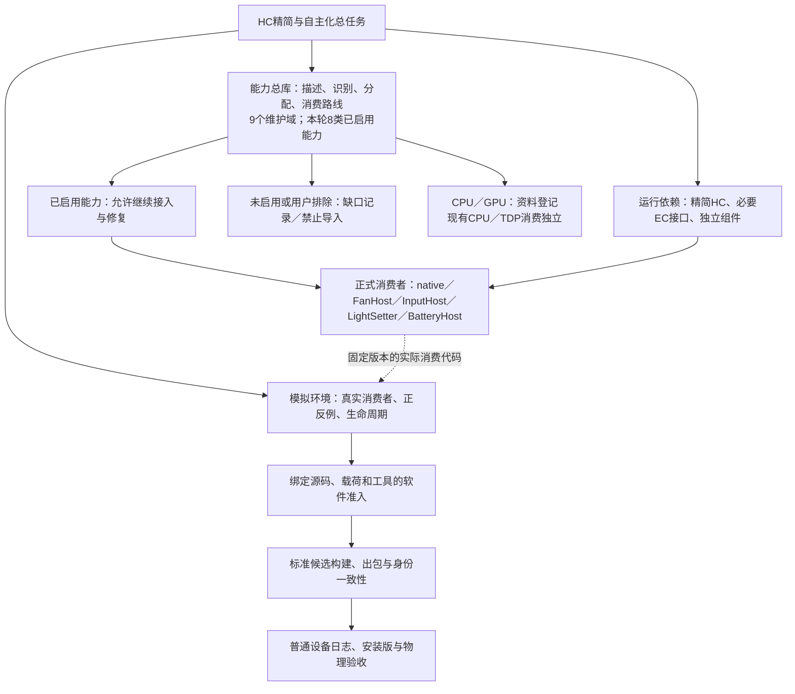

# YMCC能力总库：任务关系、数量与验收边界

更新：2026年10月20日，Asia/Hong_Kong。数量取自本目录实际JSON，详细来源哈希见[数量快照](OVERVIEW-COUNTS.json)。本文件是维护说明，不参与运行时分配，不新增准入门或永久测试任务。

## 1. AI先读的结论

能力总库是HC精简／自主化工程中的一个子任务，负责机型身份、能力事实、统一分配与消费路线；HC工程还包括设备工厂、资源与依赖闭包、运行库、构建／打包／升级和回滚。模拟环境对真实消费者提供绑定版本与范围的软件验收。三者互相反馈，但交付与完成范围分别记录。

当前是**9个维护域、8类获准继续接入的已启用能力、92个源码机型类（80个factory类）、397条方法声明、191个不同方法名、21个方法分类组**。这些口径均有独立定义，不能互相替代。

本轮8类为：风扇、陀螺仪、手柄输入、机身灯光、背部按键、专用按键、震动、充电上限。未启用副屏等只记录缺口；唤醒密码UI是用户明确排除项。CPU／GPU目前只登记资料，现有CPU／TDP消费独立。进一步删DLL仍按用户决定暂缓。

## 2. 总览图

图示包含任务、数据及验收关系。正式功能的运行路径由已有消费者调用后端；模拟器在开发验收时执行，不成为日常调用中转层。HC剩余依赖只有在实际消费与生命周期迁移完成后才能减少。

## 3. 总数量的统计口径

| 口径 | 数量 | 含义 |
|---|---:|---|
| 维护域 | 9 | INTEGRATION-STATUS中的技术维护分类，含依赖与资料域 |
| 本轮已启用产品能力类 | 8 | ACTIVE-INTEGRATION-SCOPE中用户允许继续接入的分类 |
| 源码机型类 | 92 | 冻结Devices源的类声明，包含基类；不是实测设备数 |
| 可由工厂实例化的类 | 80 | 上述92类的子集；不是80条完整硬件验收 |
| 机型源码文件 | 91 | 机型类的来源文件数 |
| 方法声明 | 397 | 按所属类计数，重写／重复名称仍是不同声明；包含生命周期和协议内部方法 |
| 不同方法名 | 191 | 方法名去重，仍不等于191个独立产品功能 |
| 方法分类组 | 21 | 分类上述397条声明的审查组 |

当前身份源基线为HC-BINARY-BATCH12-20260831，源码项目版本0.32.3.2；实际派生HC运行库的程序集版本为0.32.4.0。来源与二进制版本分别保留，不声称逐方法等价。10月18日自主化预评估中的90类是另一份候选源预览，不能覆盖本库当前92／80的口径，也不自动启用新版能力。

| 维护域 | Devices方法声明数 | 当前登记／消费口径 |
|---|---:|---|
| 风扇 | 54 | 70条既有风扇注册路由 |
| 机身灯光 | 86 | 47个灯光机型类 |
| 充电/电池 | 19 | 40条精确身份规则／10个provider路由 |
| OEM背键/专用按键 | 38 | 复用既有OEM档案与精确机型绑定；背键和专用键分别准入 |
| 陀螺仪/机身运动 | 2 | 95份配方／5张表 |
| CPU/GPU性能资料 | 35 | 92类资料；新增运行消费为0；不接管现有CPU/TDP |
| 设备生命周期与依赖 | 121 | 只服务已准入能力所必需的初始化、所有权、停止、恢复和依赖 |
| 其余机型方法/停用能力审查 | 6 | 初始化策略及副屏等方法审查；未启用部分保持记录 |
| 手柄输入/运动/配置/反馈 | 36 | 2个标准输入provider；Legion体感2个协议／4个绑定；实体反馈2个provider |
| 合计 | 397 | 只合计这一列的方法声明；不合计各域异质的路由／规则／配方数 |

这397条只覆盖冻结Devices方法声明，未把Controllers、native处理链及所有外部算法也算入同一分母。体感域只有2条Devices方法声明不代表体感只有2项功能。

补充细目：体感配方为Reviewed 27、Legacy 57、Default 3、Generic 2、Private 6，合计95。标准输入provider为XInput和MSI DInput各1；冻结Controller来源29份文件、28个类声明。MSI背键配置登记4类机型、8个固件条目、2条路线，其中1条已有消费者、1条仅记录；不能把记录路线解释为可执行。已登记的游戏电机回执profile为3，不能当作3类实物设备均已验收。

## 4. 当前接入完成在哪里

原定B40范围为17项核心消费、5个R3公共入口（对应原两套家族和既有反例）、2条实际触发的睡眠DLL软件消费者，精确24项。注册审计全部有效，原反例／截止／停止归还条件保留。执行后7694份源码和26包749份工具一致。另3条旧生命周期场景通过并单列为连续性证据，合并27项审计不扩大原24定义。

本轮来源限定的软件接入已收口。证书入口在INTEGRATION-STATUS.currentBatchAcceptance.latestFixedSoftwareBatch及EXECUTION-CHAINS.collaboration.latestFixedSoftwareAcceptance。其引用B40证书，广义goalComplete和activeScopeComplete仍保留false；变化后的整条主线、全provider、安装与实机不能由B40结果代签。

93个运行库／共享文件的本次哈希核对属于静态身份复核，未启动Host、CLR初始化或设备；不新增软件／实机通过结论。没有整体CPU节省百分比。

## 5. HC精简现状与总库的包含关系

| 项目 | 当前事实 | 仍需保留的边界 |
|---|---|---|
| HC精简／自主化总工程 | 覆盖依赖审查、最小运行库、设备资源生命周期、标准出包与迁移 | 总库接通不能代替加载／初始化／停止归还和出包验证 |
| 能力总库子任务 | 描述、识别、登记、分配、现有消费与路线问题统一记录 | 登记和静态方法分类不能自动变成已启用能力 |
| 模拟环境配套 | 运行正式消费代码，测试正常、失败、取消、停止与恢复，并核对版本身份 | 软件准入对应具体源码／载荷；安装和硬件证据单列 |
| 现行派生DeviceCore | 85个清单数据文件，14,343,708字节，约13.68MiB；含manifest为86个文件 | 82个DLL含5个批准导数；其余77个按原件合同保留。FanHost／部分灯光仍有HC消费 |
| 独立共享运行库 | 8个文件，2,886,728字节，约2.75MiB | 三方组件独立归属，不因放在旧HC目录就算HC自有实现 |
| 进一步DLL缩减 | 用户已暂缓 | 本轮不删库，不执行S6清零；仅记录未来依赖迁移与重验条件 |

当前运行库和共享库清单93个文件在本次只读核对中全部匹配SHA。14.34MB与2.89MB是这两个清单的各自文件字节，不含整个应用、许可证和安装残留，也不据此推算CPU或内存收益。旧10月7日任务中的“418→416、净去重复1,044,506字节”是历史候选／导出层收益，不能和当前运行库再叠加为本轮新增收益。

长远方向仍是让YMCC拥有机型事实和高频消费逻辑，让HC依赖收敛到必要硬件／EC边界；小型独立组件允许保留，第三方输入、驱动、算法按自己的职责与许可维护。

## 6. 原任务书如何接续

10月6日统一依赖挖掘任务、10月7日夜间联合任务及大小顺序修订提供消费者闭包、前像、净差集和回退规则。10月18日双线方案强调逐个完整能力迁移，10月19日六链认证说明实际消费和物理效果分别验收。后续以用户10月20日已启用范围为准：旧任务中的游戏反馈排除不覆盖后来明确允许的既有反馈；旧自主化S5不授权接管CPU／GPU／TDP；副屏不因已生成源码而启用；旧S6不自动重开已暂缓的删DLL任务。

当前工作对应“统一接入与软件证据收口”已经具备可用基线。更大范围的自主初始化、协议替代、剩余HC依赖迁移和硬件验收，按各自任务继续，不能用本轮24项的数量表示这些工作已完成。

## 7. 推荐的下一步：有限就绪、同版整体验收、再到设备

不必等待全局模拟环境把Decky、所有界面和所有未启用能力全部补齐。现在可整理准备交付候选的源码／runtime／shared／Host／工具身份与HC相关缺口；模拟环境继续补齐这些缺口，达到明确就绪条件后，在同一候选做一次HC相关完整软件验收。

1. **候选与影响对齐。** 由接线、模拟和导出负责人共用一个候选身份；审计B40旧回执适用性，列出哪些可复用、哪些因源码／载荷变化失效、哪些未执行。未启用能力不纳入。
2. **HC相关软件准入。** 已变更消费者定向复跑正常与原负例，汇总原启用能力范围。HC runtime／profile／第三方依赖及相关载荷输入变动时，按AGENTS和HC-UPGRADE-REGRESSION执行原fan connect五阶段，用实际RuntimeRoot、SharedRuntimeRoot和HostPayloadRoot；包括原件／ABI、SharpDX、Manager构造、旧坏NAudio对照与公开mock生命周期。SDK-free或null backend场景只作为各自范围证据。
3. **标准出包一致性。** 软件证据齐全后，用现有Build／Package／Verify核对候选与导出载荷，确认清单、共享加载和升级路径；涉及真实UI导入／导出时保留原手柄UI门。软件、完整Host启动与安装验收分别列明。当前评估轮不执行出包／安装。
4. **普通设备日志与性能。** 由用户／既有设备验收任务选择实际功能，验证输入、风扇、运动、灯光、充电、反馈及停止／恢复。虚拟手柄和屏蔽AI共读总库，核对物理来源、虚拟目标、屏蔽与归还各自证据。性能在功能、采样和工作负荷一致时比较；先确认消费完整，再给CPU百分比。

这四项是推进阶段，不是要求固定四轮聊天，也不意味着重新跑全部历史场景。源码和载荷不变且注册审计仍有效的证据可以复用。当前更广模拟环境仍在维护其他启用模块，不应把整个环境的永久完工当作HC这轮的先决条件。

## 8. AI阅读与维护顺序

先读本文件／数量快照 → ACTIVE-INTEGRATION-SCOPE与USER-SCOPE-DECISIONS → INTEGRATION-STATUS与EXECUTION-CHAINS → 具体域合同／实际消费者 → 对应证书和原运行结果。特别保留CONTROLLER-CONSUMPTION里尚未验证的provider／游戏消费／屏蔽归还边界，不因本轮B40通过而改成全true。

数量快照不是新的注册权威，不被生产消费。身份、policy或方法源改变后，按OVERVIEW-COUNTS.sourcePins对应的实际文件重算；旧数字保留日期，不能只改说明冒充重新验收。既有维护入口仍是tools/hc_capability_maintenance.mjs和tools/ymcc_sim/HC-UPGRADE-REGRESSION.md，不建立第二套运行时分配或永久测试门。
