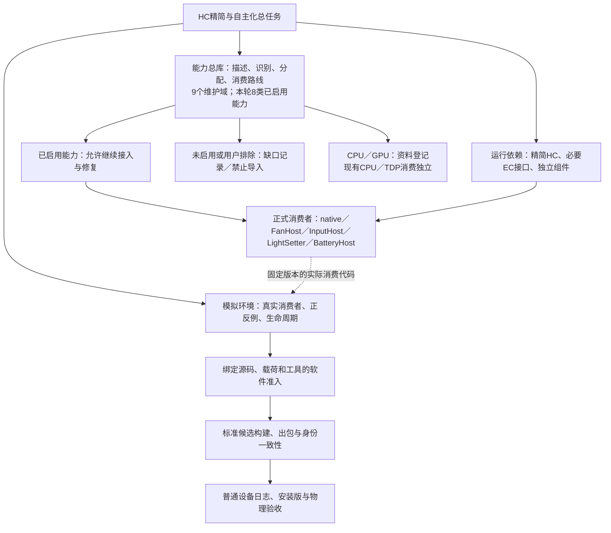

# YMCC unified HC model capability catalog

<!-- FAN-COLD-WAKE-FAN-ONLY-INITIALIZATION-20261023 -->

> **2026-10-23 风扇初始化与完整组件候选：** 公共装配已移除直接PullSensors（陀螺仪／加速度计／串口IMU），监听先就绪，认证握手按需初始化，保留机型／风扇许可与共享手柄能力。当前Host53项、完整safe自测428项、Factory24／Bootstrap56、构造器89／Joined123及原变异、候选25项原出包检查均通过；33编译输入的PE／PDB／源码绑定已实证。**正式载荷未晋级／未安装，不能用旧包验证；真机仍分列。** 后续OpenEvents内部枚举未全局移除。见 [现势回报](G:/YeManCC-Work/Docs/Tasks/Fan/FAN-920/FAN-ROGX-COLD-AFTER-WAKE-INITIALIZATION-REPAIR-20261023.md)。

<!-- /FAN-COLD-WAKE-FAN-ONLY-INITIALIZATION-20261023 -->

<!-- FAN-1296-STARTUP-MAINTENANCE-INDEX-20261020 -->

> 风扇开启/能力消费维护入口：[源码节点索引](../src/bridge/fanHost/README.md)。启动配置、部署记录、Host握手投影已集中；型号/alias继续归本总库，实际writer/交还和当前会话许可仍由原消费者判定。后续按索引联读正常、失败、取消和清理边界，并同步生命周期注释与原验证，勿另建前端全机型白名单。

<!-- /FAN-1296-STARTUP-MAINTENANCE-INDEX-20261020 -->

<!-- YMCC-AI-NAVIGATION-INDEX:BEGIN -->
## 按问题定位：AI快速入口

先读[AI导航与文件分组](AI-GUIDE.md)，需要精确检索时读[文件／域／消费者索引](AI-INDEX.json)。范围先查ACTIVE-INTEGRATION-SCOPE与USER-SCOPE-DECISIONS，实际执行按EXECUTION-CHAINS的file/anchor追踪。运行绑定顶部的AI-NAV注释指向实际消费者与实时边界。

文件按职责分列，现有路径和分配消费机制保持。生成表不手改，未启用能力只记录；索引仅作维护导航，不进入正常运行热路径。
<!-- YMCC-AI-NAVIGATION-INDEX:END -->

<!-- YMCC-CAPABILITY-OVERVIEW-20261020:BEGIN -->
## AI入口注释：总库、HC精简与验收

**截至2026-10-20：9个维护域／8类已启用产品能力／92个源码机型类（80个factory类）／397条方法声明（191个不同名称、21个分类组）。** 机型、路线、配方、规则和测试是不同单位，不能合成“能力总数”。

能力总库属于HC精简／自主化工程，负责机型事实、统一分配和现有消费；HC工程还负责最小依赖、资源生命周期和标准出包。模拟环境验证绑定版本的实际消费，不成为正常运行中转。

本轮B40原24项软件接入已收口，变化后的整条主线、安装和硬件验收仍分别记录。未启用能力只记缺口；唤醒密码UI用户排除；CPU／GPU仅资料，现有CPU／TDP独立；进一步删DLL暂缓。

详细类型、准确数量、HC任务关系与后续顺序见[总览说明](OVERVIEW.md)，机器可读统计及来源哈希见[数量快照](OVERVIEW-COUNTS.json)。当前状态以ACTIVE-INTEGRATION-SCOPE、INTEGRATION-STATUS、EXECUTION-CHAINS和具体域合同为准；下文保留的历史阶段说明不覆盖最新来源限定证书。
<!-- YMCC-CAPABILITY-OVERVIEW-20261020:END -->

<!-- FAN-1294-MSI-USER-SELECTION-HC-ALTERNATIVE-20261019 -->

> **2026-10-19 用户选择已写入顶部机型能力总库：微星首选YMCC fan-only家族方案，HC完整家族方案保留备选。** 四精确身份A1M/A2VM/BZ2EM/CG3EM沿用已接通的生产适配；主方案继续使用HC结构化WMI／专用Release。现已将C8EX两份10/16日志的四条释放／Close收据补入FAN-RETURN-CONSUMPTION.json，保留版本、行号及物理范围。备选未放弃，但没有现成UI切换或自动failover；HC底层仍必需，不因此删除。详细选择集中在总表familySelectionPolicies.MSI；EXECUTION-CHAINS和INTEGRATION-STATUS引用同一项。见 [采用与用户选择记录](G:/YeManCC-Work/Docs/Tasks/Fan/FAN-920/FAN-1293-C8EX-MSI-HANDBACK-ADOPTION-REVIEW-20261019.md)。

<!-- /FAN-1294-MSI-USER-SELECTION-HC-ALTERNATIVE-20261019 -->

冻结 HC 的全部机型能力统一登记、分配、调用和消费是持续目标。现已接通全部既有风扇分配，并接通灯光机型/动作和电池精确规则的实际消费者；风扇、陀螺仪等高频链路的最短消费路径优先。各域完成状态见 INTEGRATION-STATUS.json，调用链、中转、依赖和问题见 EXECUTION-CHAINS.json。登记和源码声明不表示完整目标或实机验收完成。

## Authoritative sources and consumption

- hc-device-catalog.json is generated from the controlled frozen Devices source with Roslyn. It retains inheritance, conditional and runtime capability operations, parameters, method anchors/hashes and OEM chord expressions. Its 92 source classes include 80 factory-instantiable classes and base classes; neither count is a physical-machine claim.
- Pinned binary type aliases are read through ECMA-335 metadata without loading HC. Source and binary provenance remain separate. Missing frozen factory types, ambiguous aliases, changed source bytes and stale generated artifacts are refused.
- HcDeviceCapabilityCatalog.generated.cs compiles this same identity and source-declaration data into the existing YeManFanBackend assembly. No additional runtime DLL or external JSON lookup is introduced.
- HcDeviceCapabilityCatalog.Bind snapshots the actual domain consumers. Exact registered identities and aliases select an existing consumer; family inheritance, a class-name suffix or a declared source flag cannot create an available runtime route.
- RealHcBackend.ResolveRoute uses this dispatcher for all 70 existing fan registrations. Domain writers, live readiness, authorization, lease, release and restore rules remain their actual consumers' responsibility. Route diagnostics expose the unified ID and source baseline.
- The existing ASUS writer resolves through the same identity catalog. Its descriptor and actual operation receipts expose CapabilityId while retaining legacy DeviceId compatibility.

## Generation and verification

Controller source inventory is checked with the existing Roslyn audit tool against all frozen Controllers files. Only exact `ButtonFlags` and `ControllerCapabilities` syntax references count; comments and similarly named enums are excluded. These are source mentions, including conditional and inherited consumers, and never prove physical availability. `controller.unified-source-inventory` runs this check and rejects nine altered inventories in the existing global simulator.

Run node tools/hc_capability_catalog_generate.mjs to regenerate after an explicitly reviewed source/policy change. Run the same tool with --check to reject stale data. --out selects isolated extraction/build evidence; --generated-root supports isolated output validation. Source declarations never become hardware-success flags.

The maintained simulator provides fan.unified-capability-dispatch and fan.unified-capability-roundtrip. The first builds the actual Host and executes its production resolver for every frozen class and known alias, verifies the actual selected consumer and denial boundaries, and never enters Host Main. The second executes the real ASUS Host/writer pipeline against in-memory transport and the pinned original HC software callback. Both keep physical device acceptance separate.

## Existing ASUS ownership contract

The production consumer is `RealHcBackend.ApplyAsusCurveViaBackend`. An explicitly selected `--fan-provider backend` session resolves a stable device ID, obtains the process-local fan lease, applies through the existing real writer, and records an operation result. The Host retains responsibility for ACPI open/close and the existing restore/suspend sequence. The default provider remains `hc`.

A recorded complete transport is not a BIOS acknowledgement. Partial, short and unknown results remain distinct. The existing outer observation scope still receives all per-fan receipts; the new session records their scope ID without stealing or replacing those receipts.

Explicit handoff requires the latest default-curve operation to have complete transport, the YMCC handle to be closed, the release generation to remain current, and an actual HC-handle closure predicate. Failure to prove the latter retains the legacy writer block until process exit. The callback is never an automatic retry after uncertain IO. This catalog controls only its own process and callers; existing service-level admission remains necessary.

The isolated `tools/fixtures/fan_capability_host_roundtrip` fixture compiles the actual Host sources, verifies this production consumer, and calls the hash-pinned original HC DLL with an injected in-memory terminal transport. It does not construct a real device, run the normal Host entry point or validate a physical fan. Its standalone runner is not shipped to handhelds.

The remaining independent ASUS work is device detection, bootstrap, complete restore/readback ownership and removal of the HC factory/lifecycle dependency. Four catalog aliases do not imply four machines were physically tested.

## 长期维护、性能与升级

总库保存能力来源、精确机型别名、实现入口、动作条件、必要依赖、失败回执和未接通原因。EXECUTION-CHAINS.json 是可机读的消费与问题账，不把源码声明当成可执行能力，也不复制另一份协议实现。

长期目标是让 HC 依赖收敛到 EC 类硬件能力；YMCC 直接消费或职责明确的小 DLL 可以保留。本次不继续裁剪 DLL。最强 CPU 性能是持续目标：高频风扇、陀螺仪及采集/提交消费者优先，单次启用和低频操作的深度优化后移。

风扇用 HcCapabilityTypeCache 保留不可变 Type→能力/写者绑定。相同 Type 的反复消费不查机型字典；Type 改变、未知 Type、无设备和显式失效均有实际 Host 测试。缓存不保存设备、句柄、权限、就绪、租约或归还结果。陀螺仪仅对满足原通用机型前置条件、五个原始 DMI 字段不变的纯配方选择作线程内缓存；改变任一字段即重算，已知掌机伪装通用机仍被拒绝。传感器配对、新鲜度、源所有权、电源与发布代际保持逐帧验证。

使用 node tools/hc_capability_maintenance.mjs --out <仓库外证据目录> 检查消费入口和问题是否仍匹配源码；可附 --candidate-catalog <候选总账.json> 生成按来源、别名、方法、动作/提供者和依赖谱系差异的重验计划。候选始终标记为未核验输入，工具不会替换二进制或修改政策。生成器、实际消费者正反测试、来源/载荷身份、普通制包和同版现场日志共同构成受控升级链。

正常构建/制包先运行 verify-unified-capability-catalog.ps1，拒绝过期生成物、失踪消费者、失效源码锚点和未登记的路线问题。只登记的新域仍明确保留 pending。局部每次调用的耗时和整程序 CPU 占用分别记录；局部加速比例不得外推成整个 YMCC 的比例。

## 灯光消费

hc-lighting-policy.json 只描述对冻结声明的已核验执行差异；C#/C++ 动作表由同一生成器输出。当前47个登记类含44个工厂类与3个明确基类别名，42个亮度路线、21个第二色条目与11个OneX命名预设；Mini的串口status/preset保持不可用。ROG和MSI选中原有原生消费者，Mini solid/rainbow保持已锁定独立核心，其余走现有LightSetter/HC生命周期。

原生入口一次解析共享机型，再直接索引动作/后端；LightSetter把启用前已校验的operation传给执行体。助手回执绑定请求与实际机型、动作和总库指纹，保留可能已发生的队列写入证据；错误、短写和超时不成为成功。lighting.unified-capability-dispatch执行真实托管决策、ROG/MSI组包与普通回执，lighting.signal-consumer执行现有产品消费者。gyro.recipe-dispatch-hotpath保留原选择器、五个原始字段失效以及五种成功编译后必须失败的错误缓存键，完整矩阵和35种原语义破坏由既有gyro.machine-motion-consumers负责。

## 电池消费与完整性优先

当前优先补齐登记、实际调用、实际消费、失败回执与退出/恢复闭环，开销只作记录。链路未执行到实际消费者或未归还，不能据较低耗时认定性能改善。

电池保留原审阅的40个精确身份组、10个Windows提供者路线，由共享 HcBatteryCapabilityCatalog 实际选择原Route对象；其中34个是冻结HC机型身份，6个是已批准本地扩展。frozen-HC-identity仅指机型来源；GPDWinMini_HX370的原生固件路线有独立审阅，不能因冻结HC没有声明而关闭。6个扩展使用ymcc.device编号并明确标记reviewed-native-extension，不冒充冻结源码机型。SuiPlay继承的声明仍按原研究allowlist不开放Windows写者，原因入账。

每个现有精确身份都执行Controller读、写和软件旁路关闭恢复的内存闭环。原固件门、档位、独立回读、并发冲突、恢复记录和实际原生提供者测试继续保留。返回Snapshot增加能力/规则编号、机型来源、冻结声明布尔值和总库指纹，不把声明布尔值作为运行可用门。

四个共享总库源文件直接编入既有BatteryHost，不增加运行库DLL或新的总库服务中转。电池native/Host的sourceId合同覆盖这些共享源码；总库生成物变化后必须重新生成电池合同并构建匹配产物，旧Host不可伪装为新消费。现有battery.charge-workflow场景使用真实Policy、Controller、提供者与实际组件消费，假设备仅位于IO终端；物理充电接口效果另行验证。

运动总库目前登记89条原生配方（27 reviewed、57 legacy、3 default、2 generic），选择时验证原表槽位、精确矩阵对和来源哈希；实际 Bound 消费同一个原配方引用。4条controllerPreferred声明仍禁止接入Windows传感器。私有OEM/MSI提供者、手柄来源及最终提交尚未全接，motion仍未完成。

手柄不是OEM按键的同义项。完整来源、按键/轴/背键、运动/校准、虚拟输出、物理屏蔽及归还入口见 `CONTROLLER-CONSUMPTION.json`。后续虚拟手柄与屏蔽AI必须按实际物理控制器身份追踪，不能从主机DMI给外接手柄分配能力；该文件是待接入合同，不是运行时已接通或硬件验收回执。

标准手柄输入已通过 `HcControllerInputCapabilityCatalog` 分配给真实 `inputHostFrameSubmissionSample`，现有XInput两种精确来源标签与MSI DInput标签接入；原物理来源、读取窗口、MSI代际、Host/意图/最终写入和中性归还校验保持。总库记录全部29个Controllers来源文件，但不据此开启背键、触摸、手柄运动、震动/灯光或屏蔽能力；这些仍按 `CONTROLLER-CONSUMPTION.json` 分批接通。

## CPU/GPU 资料与独立 TDP 边界

按2026-10-19用户裁决，`hc-performance-metadata.json` 仅登记机型、CPU名称/型号证据、冻结OEMCPU/OEMGPU声明和原始频率/功耗参数来源。该资料由既有Roslyn语法盘点器的工厂上下文生成，保留厂商、产品、版本、CPU精确分支、条件表达式及default；不创建新的运行时匹配器。没有明确CPU名称的机型保持未知，类名与能力标记不能替代CPU身份；CPU营销名称中的GPU文字不能作为实际显卡识别证据。

此JSON没有产品运行时消费者，不新增HC CPU调用，不接管当前CPU控制，不启用GPU功能。TDP保持现有独立调度与提供者，冻结nTDP/cTDP/CpuClock/GfxClock仅作局部源码资料，继承通过原类链引用，不能覆盖YMCC当前限制。现有被政策停用的CPU功能也不能因登记而开启。登记类数不是CPU或GPU已支持的机型数。

资料单独输出并由正常总库生成器检查，现有运行时总账及C++/C#生成物不加入该域或更换消费指纹。维护检查拒绝资料被改成可用能力、CPU调用授权、TDP接管或GPU启用；任何未来消费接线均需新的明确任务与对应实际消费者验收。

## OEM 输入实际消费

`HcOemInputCapabilityBinding.h` 将总库机型身份绑定到原始profile编号和原静态键表引用。主线采集门实际发布该profile供原hook规则求值；按下键枚举与`oem.keys.get`使用同一绑定。查询中的captureImplemented/captureRoute以同一canonical身份执行原判据，避免已登记alias拿到目录却漏掉SteamDeck未实现物理读者或OneX来源说明。日志仍保留原始机型身份，目录声明不等于物理采集成功。

每线程只保留immutable family/class与原profile/key表，不共享无锁可变cache；机型变化重新绑定，不复制键表、不增加DLL或逐帧JSON查询。GPD接口/代次、MSI来源权威、ROG设备身份和Raw/Hook归属、keyup及来源退出仍由原实时门负责。未知类和已审阅扩展继续原family fallback。

`controller.unified-oem-input-binding`覆盖实际main辅助函数与gate选择/exchange/epoch原片段；`controller.unified-oem-input-consumers`进一步编译完整gate/query/pressed/hook与raw reset，硬件身份、hook安装和日志终端是内存边界。原remaining-model回归继续执行原query/hook/disable消费；实际vendor/WMI生命周期、最终动作与物理效果尚需后续闭环，不宣布整个OEM输入完成。NEXT2专项的历史None尾部假设已按后续批准的Ayaneo3/OneXX2MiniPro准确尾序更新，旧profile编号和表内容仍逐项对拍，并增加尾序交换负例；修前原main同样失败的证据保留。

## Legion 手柄运动来源绑定

`HcControllerMotionCapabilityCatalog`把现有LegionGoTablet/Tablet2/SZ1/SZ2四机型绑定到两种原解码protocol。原VID/PID数组通过既有谓词引用，字节布局、符号/缩放/轴变换继续直接调用原`legion_input_protocol.h`；生成器锁定该原文件哈希及冻结Controller来源，不复制另一份解码器。

原精确canonical机型/family门改由一次保留的总库绑定消费，未知、基类、注册别名或错误family仍不扩大原生准入。每线程只缓存immutable机型/protocol；设备身份、VID/PID/collection、Ready、新鲜度、epoch、采样银行和所有权继续实时判断。缓存分配失败直接拒绝本次调用，不返回旧型号。

实际selected/raw/diagnostic Source带`capabilityToken`，Lease和BankEvidence核对同一绑定；selected Session处理前及最终提交、后台非选中银行工作再次拒绝不符token。Generic纯Lease可使用0作为不带提供者的测试数据，原生publish/snapshot/最终消费者不接受未绑定来源。查询/导出记录token和provider总库指纹，不能从历史样本或登记行推断设备在线。

`controller.unified-motion-providers`执行真实解码、Source工厂、保留队列、Session及final/银行guard，并复用原pipe终端测试；控制器传感器身份、时钟、系统IO和GamepadMotion callback边界分别说明。实际锁定GamepadMotion DLL另有原主消费者测试，不能把回调模型当成DLL或硬件已运行。仅记录本地稳定绑定成本，缺输入/不完整消费不能视作CPU下降。其余物理手柄、MSI/Xbox私有提供者及跨域生命周期仍待接通。

风扇交回合同统一入口为 `FAN-RETURN-CONSUMPTION.json`：70条deviceId逐项保留实际RestoreStrategy、回执生产者/消费者和证据等级。4条MSI消费本次操作绑定的结构化控制位回读，4条ASUS消费scope回执，62条保留已审查的软件callback合同。Close返回、cleanup pending、释放动作和物理观察分别记录；历史2026-10-07 ClawA2VM及2026-10-16 ClawCG3EM(C8EX)释放/Close收据保留各自日期、版本和显式操作令牌日志字段缺口，不作为当前70路线整体验收。原当前输入业务回执与物理验收缺口均保留。

MSI/Xbox私有Windows运动配方现纳入同一HcMotionCapabilityCatalog的Private类：原89条加6条，保留原hc_oem_windows_motion_catalog与MSI来源摘要。实际selector取得原配方绑定，Bound和私有校准消费者校验同一引用与当前身份；MSI不再逐帧构造临时selector回执。原数值矩阵、provider、成对样本、代际及最终发布/归还校验保持。当前软件证明涵盖7种板号输入及受控采样下的实际数值DLL，完整手柄、真实设备和全域生命周期仍未验收。

<!-- FAN-1293-C8EX-MSI-HANDBACK-ADOPTION-REVIEW-20261019 -->

> **2026-10-19 C8EX交回已采用，补历史证据入口。** C8EX对应ClawCG3EM／MS-1T91；现行四MSI路线保留专用152→212清位、读回和本次操作绑定，Close另行结算。10/16 09:38及18:44真机日志均有两位ok＋Close proven；原70路线固定表漏列CG3EM历史索引，不代表未实现。保留旧版本、无显式OperationToken日志字段和物理未确认边界，不升级为当前所有机型通过。详见 [采用复核](G:/YeManCC-Work/Docs/Tasks/Fan/FAN-920/FAN-1293-C8EX-MSI-HANDBACK-ADOPTION-REVIEW-20261019.md)。

<!-- /FAN-1293-C8EX-MSI-HANDBACK-ADOPTION-REVIEW-20261019 -->

实体手动/触摸反馈现由HcControllerFeedbackCapabilityCatalog统一分配现有XInput与MSI两个写者，来源以实际物理槽/受管主游戏接口记录为准，不能按掌机DMI给外接设备分配能力。现有Ready/Start保留绑定，Finish/XInput身份与调度策略保留；MSI原source、报文、HID筛选、lease与写入在受控Win32边界下实际执行，停止结果另外纳入未决结算。游戏输出目前仅接通OutputReceived原始观察及当前会话回执；未解码或转发到实体电机，UI仍明确unclosed，手动回执和写入成功不能证明游戏反馈或实体马达响应。后续升级差异需定向重验controller.xinput-feedback-lifecycle，完整手柄和实机验收仍另列。

继续增加停止失败断言后，已修MSI StopTarget丢弃归零结果而过早清账的问题：失败同当前来源时保留owner，复用既有有界重试，预算耗尽没有持续timer；现有source发布/撤销边沿仅唤醒待归还检查，替换来源不接收旧zero。Finish/XInput身份与调度策略保留。当前64场景/299检查（诊断开关各一配置）及9类实际编译故障覆盖此软件范围，硬件是否停止仍未观测；游戏反馈与跨域联合生命周期继续未闭环。

游戏输出观察合同为 `CONTROLLER-GAME-OUTPUT-OBSERVATION.json`。当前目标通过原PnP准入后只订阅其OutputReceived；四项绑定字段与原SameTuple共同限制应答。固定256字节内存保存最新原始包并记录合并数，超长整包拒绝，callback不进行pipe或设备IO，没有新增轮询/线程。QUIESCE和Release最前撤销旧租约，再解绑；解绑异常保留重试并继续原stop/idle/dispose责任。此观察槽会合并报文，不能充当电机命令队列或完整协议记录。仅DualSense Edge锁定profile有extendedOutputReport，另两种须另验raw协议；三个模式均未开放游戏反馈。新Host/helper源码须更新managed18项输入并实际重建，旧回执不能改签。定向软件入口 `controller.host-game-output-observation`；完整native转发/仲裁/停止/实机验收仍待完成。

用户范围裁决统一见 `USER-SCOPE-DECISIONS.json`。2026-10-19用户明确：单纯“唤醒密码 UI”是YemanCC不需要、明确不导入的能力，状态USER_EXCLUDED；不计机型能力、接线缺口、待重跑或完成率分母，不随HC升级自动补回。已存在产品源码与历史原测试/回执保留，新增统一模拟活动登记撤下；这不是删除原产品设置的授权。通用设置/启动恢复UI须先证明具体机型能力的必要消费或生命周期依赖，不能仅因旧测试存在就纳入总库。必要风扇、手柄、陀螺仪与硬件归还链继续，CPU/GPU资料和独立TDP边界保持。

## Sony 游戏马达接收合同（2026-10-19）

`CONTROLLER-GAME-MOTOR-RECEIPT.json` 将锁定 SDK 的 `dualsense-edge` USB 经典马达协议接入同一总库策略，并同时生成 Host C# 与原生 C++ 绑定。Host 保留独立的马达待消费状态，灯光、统计和中性回执不清空待停止信号；实际帧成功回执由原生快速扫描与 DOM 两条既有路径接收，并检查来源、代际和修订号。未增加轮询器或运行库 DLL。

当前状态为协议解码及原生接收，不代表游戏震动已写入实体手柄。游戏/手动/触摸仲裁、实际输出、失败停止及跨进程新事件仍须闭合。原 `gameOutputCallbackBound:false` 指物理游戏输出尚未绑定；Host 观察、解码、原生接收分别由新字段明确记录。整程序 CPU 收益保留未测量。

## AYANEO 副屏能力候选（D15）

Flip DS 与冻结源码明确继承同一副屏实现的 Flip 1S DS，现有独立的精确机型消费者。总库 HcSecondaryDisplayCapabilityCatalog 绑定 SecondaryDisplayController；原生 model.secondaryDisplay.get/set/toggle/release 复用已有版本校验与辅助进程管道。只有该域收到请求才创建显示消费者，显示请求不创建充电控制器，也不读取或恢复充电日志。

沿现有 EcAccess(false) 使用 ACPI EC 字节寄存器：读0x4E，写0x4F=0，再写0x4E，独立回读。0x4E/0x4F不是 SuperIO 端口。短整数参数保持 HC 的0至100钳制及255缩放向下取整。持久亮度在退出/释放时不自动回滚，启动/恢复不自动写入。每次写入要求当前读取凭据和相同原始状态；部分失败保留unknown，禁止凭丢失回执重试或猜测恢复。

专用屏幕键沿现有键盘采样和串行任务队列消费，先见中性再接受一个按下边沿。已有快捷键或背键映射、录制及来源/电源/规则变化阻止默认动作，保持虚拟手柄和充电功能独立。没有新轮询器、线程或运行库DLL；不导入HC快工具、键盘或触控板UI。

协议与边界见 SECONDARY-DISPLAY-CONSUMPTION.json。定向软件检查为 tools/hc_secondary_display_managed_selftest.mjs、tools/hc_secondary_display_native_selftest.mjs 和 tools/hc_secondary_display_pipe_selftest.mjs，均要求仓库外新证据目录。现有电池60组及原exact-dispatch提取门继续运行。本条仍是D候选：主线小增量合入、全局登记与对应源码审计、完整产品/载荷身份、安装和物理亮度效果分别待验，不能因登记就开放未验证能力。CPU/功耗收益未测量。
